# DH.DevUtil

DH.DevUtil은 일상적인 개발 작업에 사용하는 가벼운 유틸리티 모음입니다. 각 도구는 설치나 외부 라이브러리 없이 최신 브라우저에서 실행되는 독립 HTML 파일입니다. DH.MarkDown.Flow도 독립 실행 파일 하나(`index_local.html`)로 실행되지만, Mermaid, docx 등 서드파티 라이브러리를 포함합니다.

[English](./README.md)

## 도구 목록

| 도구 | 기능 | 온라인 실행 | 소스 | 안내 |
|---|---|---|---|---|
| JSON Parser | JSON 검증·탐색·형식화·축약, Base64 값 확인 및 내장 이미지 미리보기 | [실행 (Ctrl+클릭으로 새 탭)](https://cyberkdh.github.io/DH.DevUtil/tools/DH.DevUtil.json.html) | [소스 보기](./tools/DH.DevUtil.json.html) | [사용 안내](./docs/JSON_PARSER.ko.md) |
| File Hash Calculator | 로컬 파일의 암호학적 해시, 체크섬 및 비암호학 해시 계산 | [실행 (Ctrl+클릭으로 새 탭)](https://cyberkdh.github.io/DH.DevUtil/tools/DH.DevUtil.hash.html) | [소스 보기](./tools/DH.DevUtil.hash.html) | [알고리즘 및 사용 안내](./docs/HASH_ALGORITHMS.ko.md) |
| HMAC Simulator (Base) | HMAC 태그를 계산·검증하고 Client → 전달 데이터 → Server 흐름을 확인 | [실행 (Ctrl+클릭으로 새 탭)](https://cyberkdh.github.io/DH.DevUtil/tools/DH.DevUtil.hmac-simulator-base.html) | [소스 보기](./tools/DH.DevUtil.hmac-simulator-base.html) | [사용 안내](./docs/HMAC_SIMULATOR.ko.md) |
| HTTP Digest Authentication Simulator | RFC 7616 challenge, Digest response, Server 검증 흐름 시뮬레이션 | [실행 (Ctrl+클릭으로 새 탭)](https://cyberkdh.github.io/DH.DevUtil/tools/DH.DevUtil.http-digest-auth-simulator.html) | [소스 보기](./tools/DH.DevUtil.http-digest-auth-simulator.html) | [사용 안내](./docs/HTTP_DIGEST_AUTH_SIMULATOR.ko.md) |
| JWT Inspector | 테스트 JWT 생성(HS256), 일반 JWT 파싱 및 HS256 서명 검증 | [실행 (Ctrl+클릭으로 새 탭)](https://cyberkdh.github.io/DH.DevUtil/tools/DH.DevUtil.jwt-inspector.html) | [소스 보기](./tools/DH.DevUtil.jwt-inspector.html) | [사용 안내](./docs/JWT_INSPECTOR.ko.md) |
| Number Notation Converter | `1.23457E+15` 같은 E 표기를 정확한 일반 표기, 천 단위 구분, 공학 표기, SI 접두어, 한국어 단위로 바꾸고 double·float32 저장값 확인 | [실행 (Ctrl+클릭으로 새 탭)](https://cyberkdh.github.io/DH.DevUtil/tools/DH.DevUtil.number-notation.html) | [소스 보기](./tools/DH.DevUtil.number-notation.html) | [사용 안내](./docs/NUMBER_NOTATION_CONVERTER.ko.md) |
| Regex Tester | JavaScript 정규식 테스트, match·capture group 확인, replacement 미리보기, 정규식 문법 학습 | [실행 (Ctrl+클릭으로 새 탭)](https://cyberkdh.github.io/DH.DevUtil/tools/DH.DevUtil.regex-tester.html) | [소스 보기](./tools/DH.DevUtil.regex-tester.html) | [사용 안내](./docs/REGEX_TESTER.ko.md) |
| Timestamp Converter | ISO, Unix, FILETIME, .NET Ticks 변환과 calendar duration 더하기·빼기 | [실행 (Ctrl+클릭으로 새 탭)](https://cyberkdh.github.io/DH.DevUtil/tools/DH.DevUtil.timestamp-converter.html) | [소스 보기](./tools/DH.DevUtil.timestamp-converter.html) | [사용 안내](./docs/TIMESTAMP_CONVERTER.ko.md) |
| Color Converter | HEX, RGB, HSL, HSV, OKLCH 변환, 색상 조합 미리보기, WCAG 대비율 확인 | [실행 (Ctrl+클릭으로 새 탭)](https://cyberkdh.github.io/DH.DevUtil/tools/DH.DevUtil.color-converter.html) | [소스 보기](./tools/DH.DevUtil.color-converter.html) | [사용 안내](./docs/COLOR_CONVERTER.ko.md) |
| Text · JSON Diff | 일반 텍스트와 형식화된 JSON을 로컬에서 비교하고 추가·삭제 줄 확인 | [실행 (Ctrl+클릭으로 새 탭)](https://cyberkdh.github.io/DH.DevUtil/tools/DH.DevUtil.text-json-diff.html) | [소스 보기](./tools/DH.DevUtil.text-json-diff.html) | [사용 안내](./docs/TEXT_JSON_DIFF.ko.md) |
| CIDR Calculator | IPv4 네트워크 범위, 마스크, 호스트 수, 이진수, 서브넷 분할 계산 | [실행 (Ctrl+클릭으로 새 탭)](https://cyberkdh.github.io/DH.DevUtil/tools/DH.DevUtil.cidr-calculator.html) | [소스 보기](./tools/DH.DevUtil.cidr-calculator.html) | [사용 안내](./docs/CIDR_CALCULATOR.ko.md) |
| Password Hashing Lab | Web Crypto API로 salt, PBKDF2, 반복 횟수, 파생 키 길이, 비밀번호 검증 학습 | [실행 (Ctrl+클릭으로 새 탭)](https://cyberkdh.github.io/DH.DevUtil/tools/DH.DevUtil.password-hashing-lab.html) | [소스 보기](./tools/DH.DevUtil.password-hashing-lab.html) | [사용 안내](./docs/PASSWORD_HASHING_LAB.ko.md) |
| MIME · Content-Type Inspector | Content-Type 파싱, 매개변수·suffix 확인, 파일명 확장자 비교 | [실행 (Ctrl+클릭으로 새 탭)](https://cyberkdh.github.io/DH.DevUtil/tools/DH.DevUtil.mime-content-type-inspector.html) | [소스 보기](./tools/DH.DevUtil.mime-content-type-inspector.html) | [사용 안내](./docs/MIME_CONTENT_TYPE_INSPECTOR.ko.md) |
| YAML · JSON Converter | 일반적인 설정용 YAML과 JSON을 로컬에서 변환하고 형식화된 출력 확인 | [실행 (Ctrl+클릭으로 새 탭)](https://cyberkdh.github.io/DH.DevUtil/tools/DH.DevUtil.yaml-json-converter.html) | [소스 보기](./tools/DH.DevUtil.yaml-json-converter.html) | [사용 안내](./docs/YAML_JSON_CONVERTER.ko.md) |
| PEM · ASN.1 · X.509 Viewer | PEM·DER 디코딩, JKS 인증서 추출, PKCS#12/PFX ASN.1 구조 확인 | [실행 (Ctrl+클릭으로 새 탭)](https://cyberkdh.github.io/DH.DevUtil/tools/DH.DevUtil.pem-asn1-x509-viewer.html) | [소스 보기](./tools/DH.DevUtil.pem-asn1-x509-viewer.html) | [사용 안내](./docs/PEM_ASN1_X509_VIEWER.ko.md) |
| Symmetric Encryption Simulator (Base) | AES, ARIA, 3DES, DES(ECB/CBC)와 padding 선택, 공유 Key/IV, 고정 IV로 같은 결과를 재현하며 대칭 암호화 학습 | [실행 (Ctrl+클릭으로 새 탭)](https://cyberkdh.github.io/DH.DevUtil/tools/DH.DevUtil.symmetric-encryption-simulator-base.html) | [소스 보기](./tools/DH.DevUtil.symmetric-encryption-simulator-base.html) | [사용 안내](./docs/SYMMETRIC_ENCRYPTION_SIMULATOR_BASE.ko.md) |
| Symmetric Encryption Simulator | AES-GCM/CBC/CTR 암복호화와 CBC padding 비교 | [실행 (Ctrl+클릭으로 새 탭)](https://cyberkdh.github.io/DH.DevUtil/tools/DH.DevUtil.symmetric-encryption-simulator.html) | [소스 보기](./tools/DH.DevUtil.symmetric-encryption-simulator.html) | [사용 안내](./docs/SYMMETRIC_ENCRYPTION_SIMULATOR.ko.md) |
| Unicode · Encoding Inspector | 코드 포인트, UTF-8/UTF-16/CP949 바이트, NFC/NFD 정규화, 폭 없는 공백·양방향 제어 문자 같은 숨은 문자, 글자 깨짐(mojibake)을 확인하고 16진수·Base64 바이트를 디코딩 | [실행 (Ctrl+클릭으로 새 탭)](https://cyberkdh.github.io/DH.DevUtil/tools/DH.DevUtil.unicode-inspector.html) | [소스 보기](./tools/DH.DevUtil.unicode-inspector.html) | [사용 안내](./docs/UNICODE_ENCODING_INSPECTOR.ko.md) |
| TOTP / HOTP Simulator | Base32 secret과 HMAC으로 TOTP/HOTP를 로컬 생성·검사 | [실행](https://cyberkdh.github.io/DH.DevUtil/tools/DH.DevUtil.totp-hotp.html) | [소스](./tools/DH.DevUtil.totp-hotp.html) | [안내](./docs/TOTP_HOTP_SIMULATOR.ko.md) |
| UUID / ULID Inspector | UUID v4/v7과 ULID 생성, format·version·variant·timestamp 검사 | [실행](https://cyberkdh.github.io/DH.DevUtil/tools/DH.DevUtil.uuid-ulid.html) | [소스](./tools/DH.DevUtil.uuid-ulid.html) | [안내](./docs/UUID_ULID_INSPECTOR.ko.md) |
| URL / Query Parser | URL 구성 요소와 query parameter를 로컬에서 검사·수정 | [실행](https://cyberkdh.github.io/DH.DevUtil/tools/DH.DevUtil.url-query.html) | [소스](./tools/DH.DevUtil.url-query.html) | [안내](./docs/URL_QUERY_PARSER.ko.md) |
| Cron Explainer | 5-field Unix cron 문법 설명과 다음 실행 시각 계산 | [실행](https://cyberkdh.github.io/DH.DevUtil/tools/DH.DevUtil.cron.html) | [소스](./tools/DH.DevUtil.cron.html) | [안내](./docs/CRON_EXPLAINER.ko.md) |
| Asymmetric Cryptography Simulator | RSA-OAEP, ECDSA, ECDH, Ed25519 공개키·개인키 연산 학습 | [실행](https://cyberkdh.github.io/DH.DevUtil/tools/DH.DevUtil.asymmetric.html) | [소스](./tools/DH.DevUtil.asymmetric.html) | [안내](./docs/ASYMMETRIC_SIMULATOR.ko.md) |
| API Request Signing Simulator | generic canonical request를 만들고 HMAC-SHA-256으로 로컬 서명 | [실행](https://cyberkdh.github.io/DH.DevUtil/tools/DH.DevUtil.api-signing.html) | [소스](./tools/DH.DevUtil.api-signing.html) | [안내](./docs/API_REQUEST_SIGNING.ko.md) |
| DH.MarkDown.Flow | Source·WYSIWYG·Split 편집, Mermaid 다이어그램, Markdown/HTML/PDF/Word 내보내기를 지원하는 로컬 우선 Markdown 편집기 | [실행 (Ctrl+클릭으로 새 탭)](https://cyberkdh.github.io/DH.DevUtil/tools/DH.MarkDown.Flow/index.html) [오프라인 버전 다운로드 (우클릭 → 다른 이름으로 링크 저장)](https://raw.githubusercontent.com/cyberkdh/DH.DevUtil/main/tools/DH.MarkDown.Flow/index_local.html) | [파일 보기](./tools/DH.MarkDown.Flow/) | [사용 안내](./docs/MARKDOWN_FLOW.ko.md) |

온라인 데모는 GitHub Pages에서 정적 HTML 도구를 실행합니다. 소스 링크는 GitHub에서 HTML 코드를 보여줄 뿐 도구를 실행하지 않습니다. 오프라인으로 사용하려면 저장소를 clone하거나 도구 HTML 파일을 내려받아 브라우저에서 여세요. DH.MarkDown.Flow는 `index_local.html`을 여세요. `index.html`은 웹 서버가 필요합니다.

## HTTP Digest Authentication Simulator 미리보기

RFC 7616 challenge 생성, Client response 계산, Server 검증과 계산 상세를 한 화면에서 확인할 수 있습니다. 자세한 기능과 사용 방법은 [HTTP Digest Authentication Simulator 안내](./docs/HTTP_DIGEST_AUTH_SIMULATOR.ko.md)를 참고하세요.

## JWT Inspector 미리보기

테스트 JWT 생성, compact token 파싱, HS256 서명 검증과 상세 정보를 확인할 수 있습니다. 자세한 기능과 사용 방법은 [JWT Inspector 안내](./docs/JWT_INSPECTOR.ko.md)를 참고하세요.

## Number Notation Converter 미리보기

`1.23457E+15` 같은 E 표기를 정확한 10진 변환으로 읽기 쉬운 숫자로 바꾸고, double·float32에 실제로 저장되는 값을 확인할 수 있습니다. 자세한 기능과 사용 방법은 [Number Notation Converter 안내](./docs/NUMBER_NOTATION_CONVERTER.ko.md)를 참고하세요.

## Regex Tester 미리보기

JavaScript 정규식을 테스트하고 모든 match·capture group을 확인하며 replacement token 결과를 미리 볼 수 있습니다. 프로그래밍 언어별 정규식 flavor 차이와 기본 문법도 학습할 수 있습니다. 자세한 기능과 사용 방법은 [Regex Tester 안내](./docs/REGEX_TESTER.ko.md)를 참고하세요.

[Regex Tester 안의 초보자용 Regex 학습 가이드 열기](./tools/DH.DevUtil.regex-tester.html#guide-lessons)에서 단계별 문법 설명과 실행 가능한 예제를 볼 수 있습니다.

## Timestamp Converter 미리보기

ISO 8601, Unix 단위, Windows FILETIME, .NET Ticks 사이를 변환하고 calendar duration을 날짜에 더하거나 뺄 수 있습니다. 자세한 기능과 사용 방법은 [Timestamp Converter 안내](./docs/TIMESTAMP_CONVERTER.ko.md)를 참고하세요.

## Color Converter 미리보기

HEX 색상을 RGB, HSL, HSV, OKLCH로 변환하고 전경색·배경색 조합을 미리 보며 WCAG 대비율을 확인할 수 있습니다. 자세한 기능과 사용 방법은 [Color Converter 안내](./docs/COLOR_CONVERTER.ko.md)를 참고하세요.

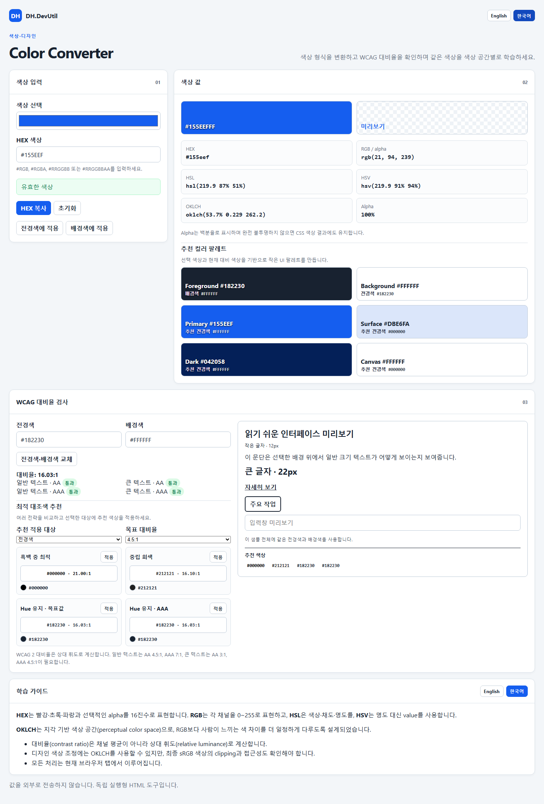

## Text · JSON Diff 미리보기

일반 텍스트와 형식화된 JSON을 로컬에서 비교하고 추가·삭제 줄을 확인할 수 있습니다. 자세한 기능과 사용 방법은 [Text · JSON Diff 안내](./docs/TEXT_JSON_DIFF.ko.md)를 참고하세요.

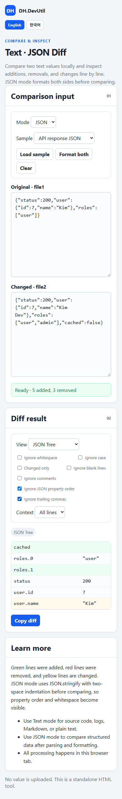

## CIDR Calculator 미리보기

IPv4 네트워크 범위, 마스크, 호스트 수, 이진수, 서브넷 분할을 로컬에서 계산합니다. 자세한 기능과 사용 방법은 [CIDR Calculator 안내](./docs/CIDR_CALCULATOR.ko.md)를 참고하세요.

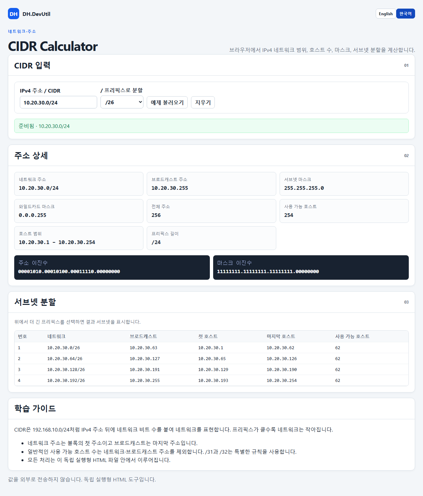

## Password Hashing Lab 미리보기

PBKDF2가 salt, 반복 횟수, 키 길이를 사용하는 방식을 학습하고 Web Crypto API로 비밀번호를 로컬 검증합니다. 보안 안내와 사용 방법은 [Password Hashing Lab 안내](./docs/PASSWORD_HASHING_LAB.ko.md)를 참고하세요.

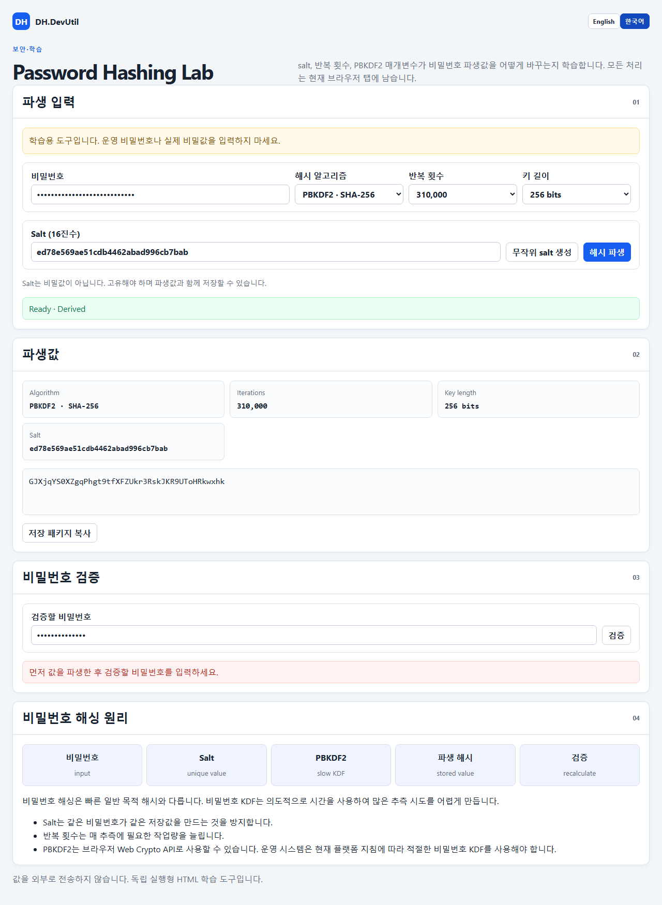

## MIME · Content-Type Inspector 미리보기

Content-Type 헤더를 파싱하고 매개변수·구조화 suffix를 확인하며 파일명 확장자를 로컬에서 비교합니다. 자세한 기능과 사용 방법은 [MIME · Content-Type Inspector 안내](./docs/MIME_CONTENT_TYPE_INSPECTOR.ko.md)를 참고하세요.

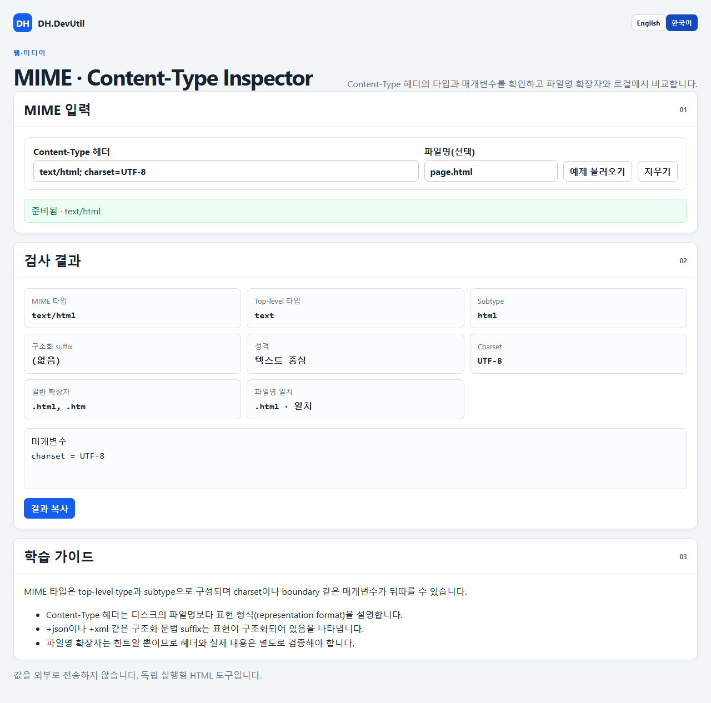

## YAML · JSON Converter 미리보기

일반적인 설정용 YAML과 JSON을 로컬에서 변환하고 형식화된 출력과 mapping·sequence 샘플을 확인합니다. 지원 문법과 제한 사항은 [YAML · JSON Converter 안내](./docs/YAML_JSON_CONVERTER.ko.md)를 참고하세요.

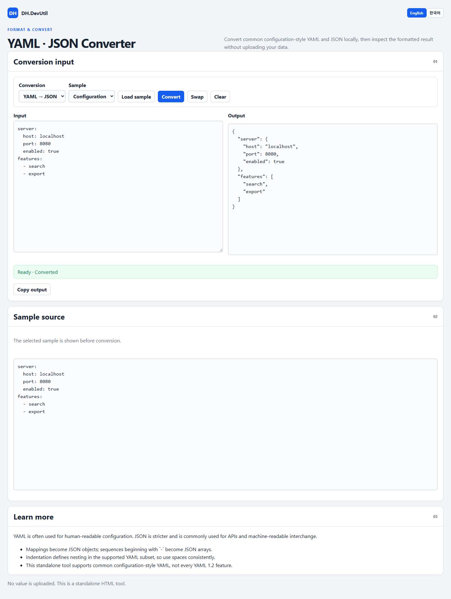

## PEM · ASN.1 · X.509 Viewer 미리보기

PEM·DER를 로컬에서 디코딩하고 중첩 ASN.1 tag와 주요 X.509 인증서 필드를 확인합니다. 사용 방법과 검증 제한은 [PEM · ASN.1 · X.509 Viewer 안내](./docs/PEM_ASN1_X509_VIEWER.ko.md)를 참고하세요.

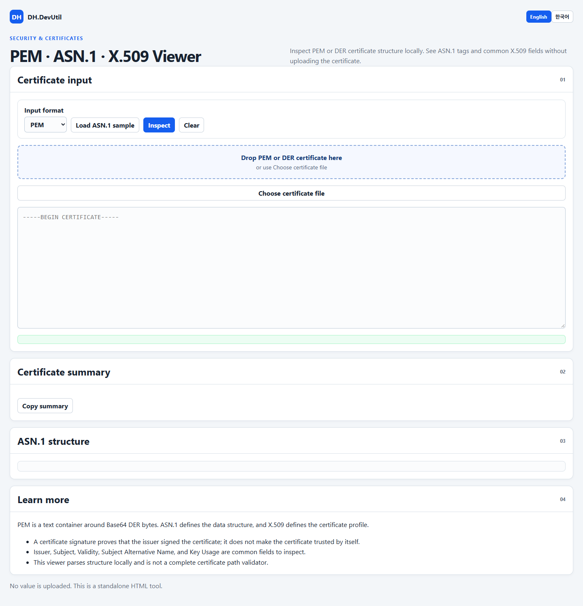

## Symmetric Encryption Simulator (Base) 미리보기

가운데의 공유 키·IV 하나로 Encrypt와 Decrypt를 수행하고, ECB와 CBC를 블록 단위로 비교할 수 있습니다. 자세한 기능과 사용 방법은 [Symmetric Encryption Simulator (Base) 안내](./docs/SYMMETRIC_ENCRYPTION_SIMULATOR_BASE.ko.md)를 참고하세요.

## Symmetric Encryption Simulator 미리보기

AES-GCM, AES-CBC, AES-CTR로 암호화하고, 키를 제외한 JSON 패키지를 만들어 복호화와 처리 상세를 확인할 수 있습니다. 자세한 기능과 사용 방법은 [Symmetric Encryption Simulator 안내](./docs/SYMMETRIC_ENCRYPTION_SIMULATOR.ko.md)를 참고하세요.

## Unicode · Encoding Inspector 미리보기

모든 코드 포인트를 UTF-8, UTF-16, CP949 바이트와 함께 보고, 숨은 문자와 NFC/NFD 차이를 찾고, 글자 깨짐을 미리 볼 수 있습니다. 자세한 기능과 사용 방법은 [Unicode · Encoding Inspector 안내](./docs/UNICODE_ENCODING_INSPECTOR.ko.md)를 참고하세요.

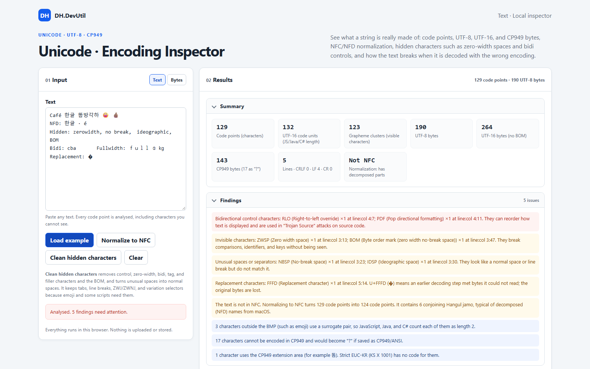

## TOTP / HOTP Simulator 미리보기

일회용 비밀번호와 counter, period, HMAC 상세를 로컬에서 확인합니다. 자세한 내용은 [TOTP / HOTP Simulator 안내](./docs/TOTP_HOTP_SIMULATOR.ko.md)를 참고하세요.

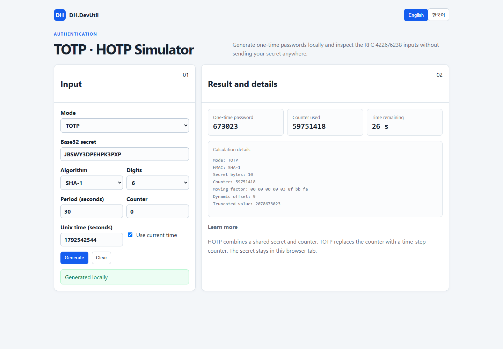

## UUID / ULID Inspector 미리보기

UUID v4/v7과 ULID를 생성하고 검사합니다. 자세한 내용은 [UUID / ULID Inspector 안내](./docs/UUID_ULID_INSPECTOR.ko.md)를 참고하세요.

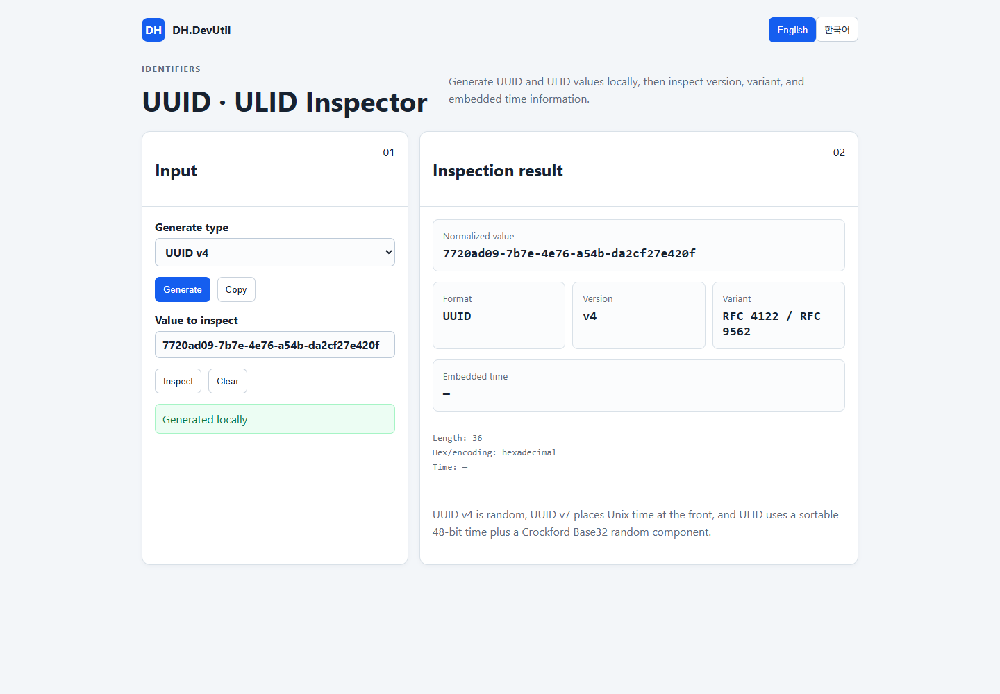

## URL / Query Parser 미리보기

URL 구성 요소와 query parameter를 로컬에서 검사·수정합니다. 자세한 내용은 [URL / Query Parser 안내](./docs/URL_QUERY_PARSER.ko.md)를 참고하세요.

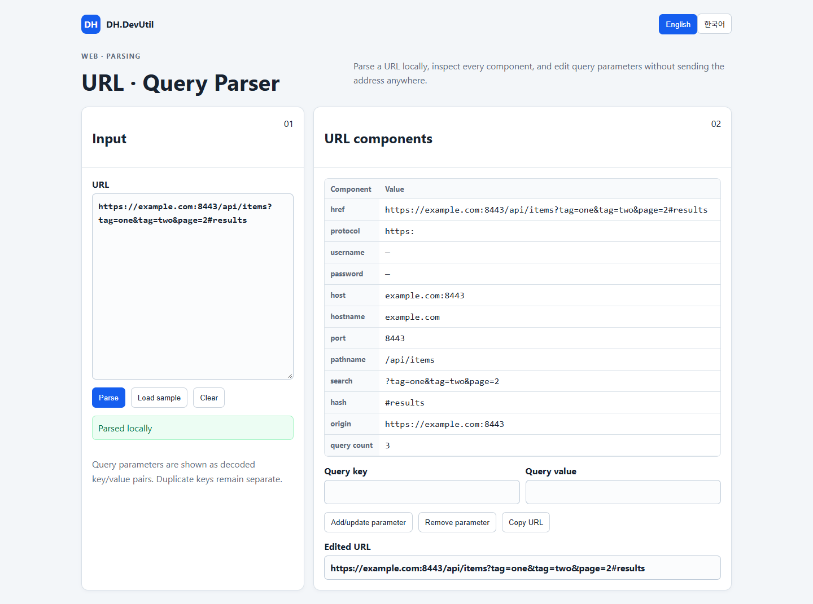

## Cron Explainer 미리보기

일반적인 Unix cron 필드를 설명하고 다음 실행 시각을 계산합니다. 자세한 내용은 [Cron Explainer 안내](./docs/CRON_EXPLAINER.ko.md)를 참고하세요.

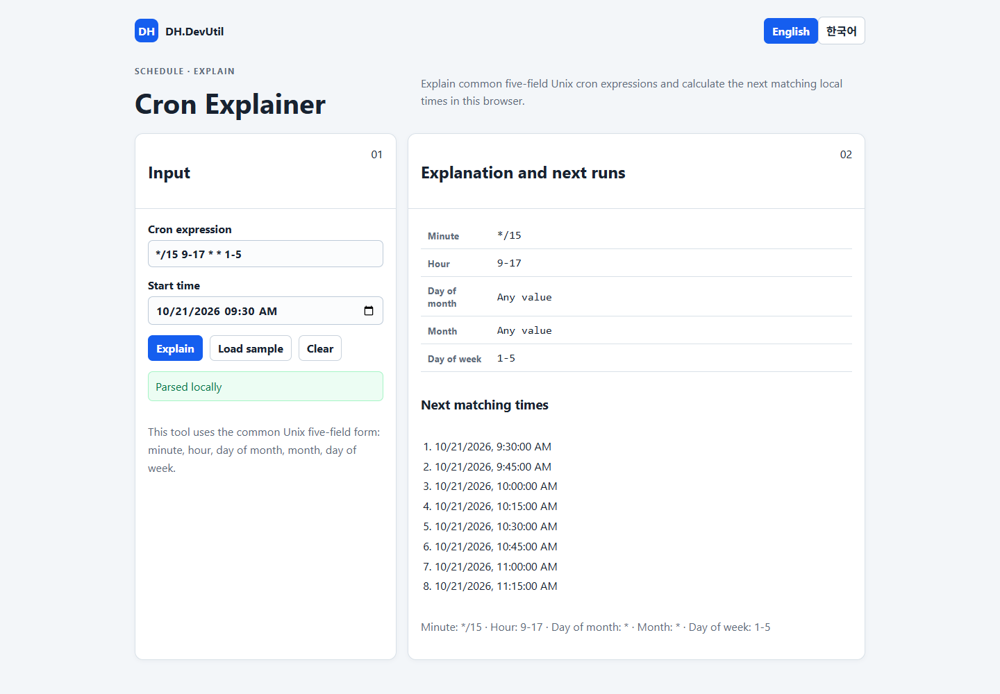

## Asymmetric Cryptography Simulator 미리보기

RSA-OAEP, ECDSA, ECDH, Ed25519 연산을 로컬에서 학습합니다. 자세한 내용은 [Asymmetric Cryptography Simulator 안내](./docs/ASYMMETRIC_SIMULATOR.ko.md)를 참고하세요.

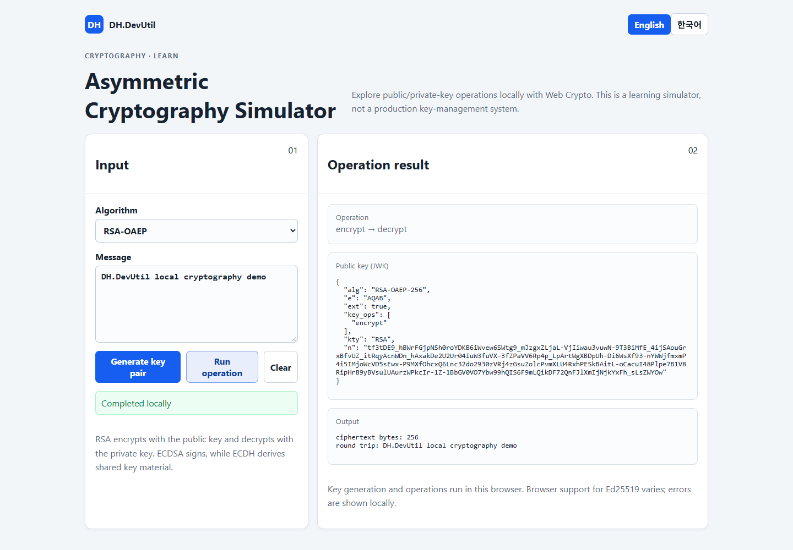

## API Request Signing Simulator 미리보기

generic canonical request를 만들고 HMAC-SHA-256으로 서명합니다. 자세한 내용은 [API Request Signing Simulator 안내](./docs/API_REQUEST_SIGNING.ko.md)를 참고하세요.

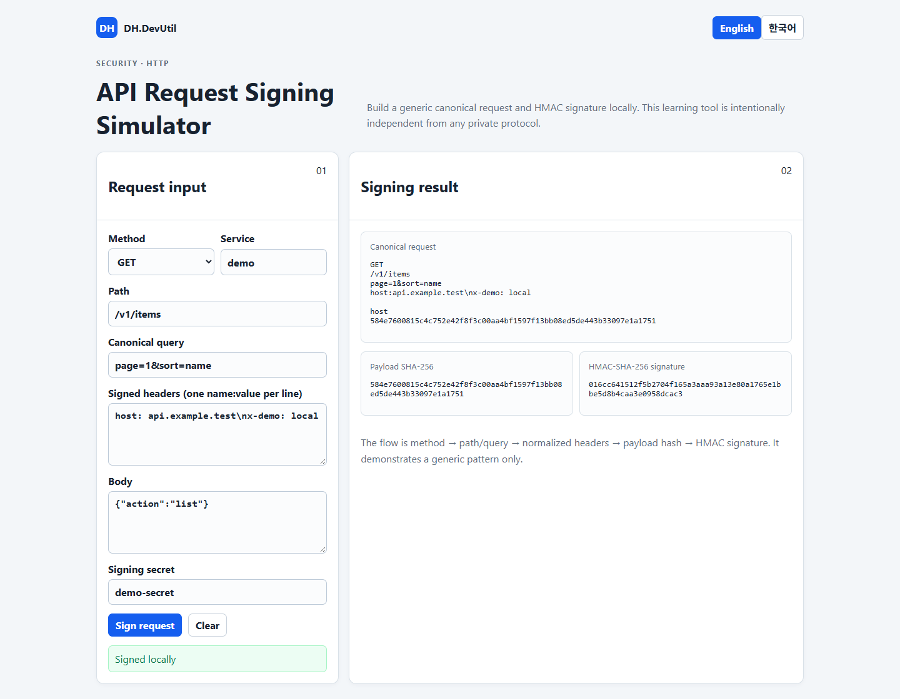

## DH.MarkDown.Flow 미리보기

Source, WYSIWYG, Split 모드로 Markdown을 편집하고, Mermaid 다이어그램을 미리보며, Markdown, HTML, PDF, Word로 내보낼 수 있습니다. 자세한 기능과 사용 방법은 [DH.MarkDown.Flow 안내](./docs/MARKDOWN_FLOW.ko.md)를 참고하세요.

## 중요 안내

- 도구 입력은 현재 브라우저에서 처리하며 DH.DevUtil 서버로 업로드하지 않습니다.
- HMAC Simulator (Base)는 키에서 파생된 중간값을 의도적으로 표시하므로 운영 비밀 키나 자격 증명을 입력하지 마세요.
- HTTP Digest Authentication Simulator는 password에서 파생된 Digest 및 계산 과정을 표시하므로 운영 password나 자격 증명을 입력하지 마세요.
- JWT Inspector는 claims와 키를 로컬에서 처리합니다. 운영 JWT, 개인정보가 든 토큰 또는 production signing key를 입력하지 마세요.
- Symmetric Encryption Simulator (Base)는 키와 중간값을 표시하고 기본적으로 고정 IV를 사용하며, DES/3DES는 학습용으로만 포함합니다. 운영 키나 개인정보를 입력하지 마세요.
- Symmetric Encryption Simulator는 로컬 AES 키와 메시지를 처리합니다. 운영 키나 개인정보를 입력하지 마세요. AES-CBC와 AES-CTR은 암호문 무결성(authentication)을 보장하지 않습니다.
- 레거시 해시와 비암호학 체크섬은 악의적인 변경에 대한 보안 용도로 적합하지 않습니다. [해시 보안 안내](./docs/HASH_ALGORITHMS.ko.md)를 확인하세요.
- DH.MarkDown.Flow는 초안을 브라우저 로컬 저장소에 저장하고, 문서가 참조하는 외부 이미지를 네트워크에서 불러옵니다. 포함된 서드파티 라이브러리는 [서드파티 고지](./tools/DH.MarkDown.Flow/THIRD_PARTY_NOTICES.md)를 참고하세요.
- 내려받은 사본을 실행하거나 다른 페이지에 도구를 삽입할 때는 도구 파일의 출처와 브라우저 환경을 신뢰할 수 있는지 확인하세요.

## 시작하기

1. 도구 목록에서 **실행**을 선택해 온라인 데모를 사용하거나, 오프라인 사용을 위해 저장소를 clone하거나 HTML 파일을 내려받습니다.
2. 해당 도구의 안내 문서를 참고합니다.

## 최근 변경 사항

미출시 변경과 정식 버전 이력은 [변경 이력](./CHANGELOG.ko.md)을 참고하세요.

## 프로젝트 문서

- [기여 안내](./CONTRIBUTING.ko.md)
- [보안 정책](./SECURITY.ko.md)
- [MIT License](./LICENSE)
