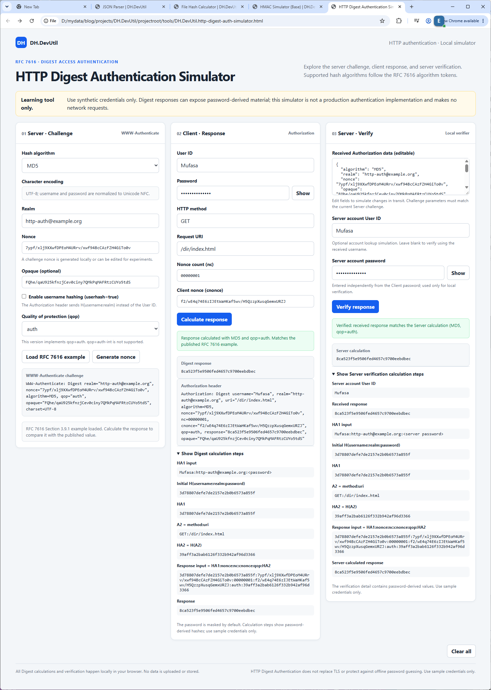
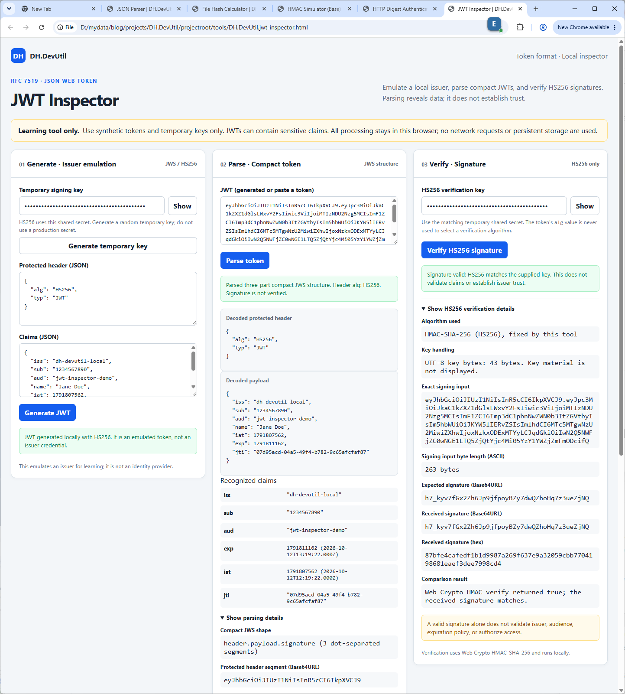
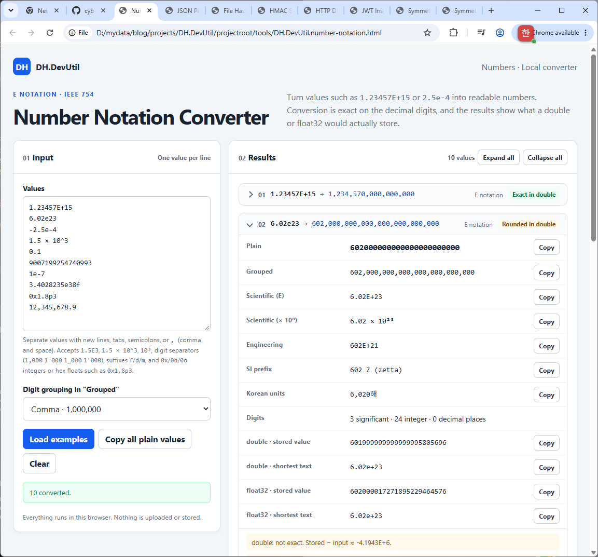
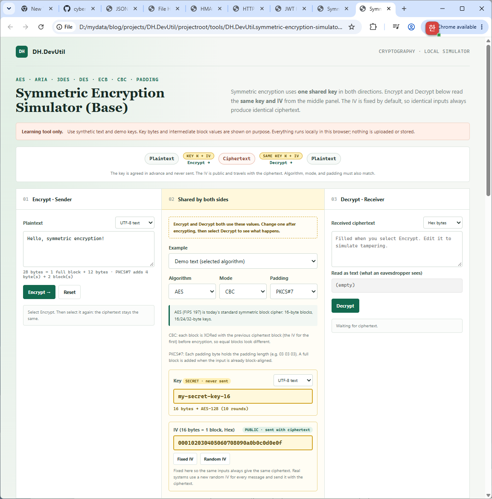
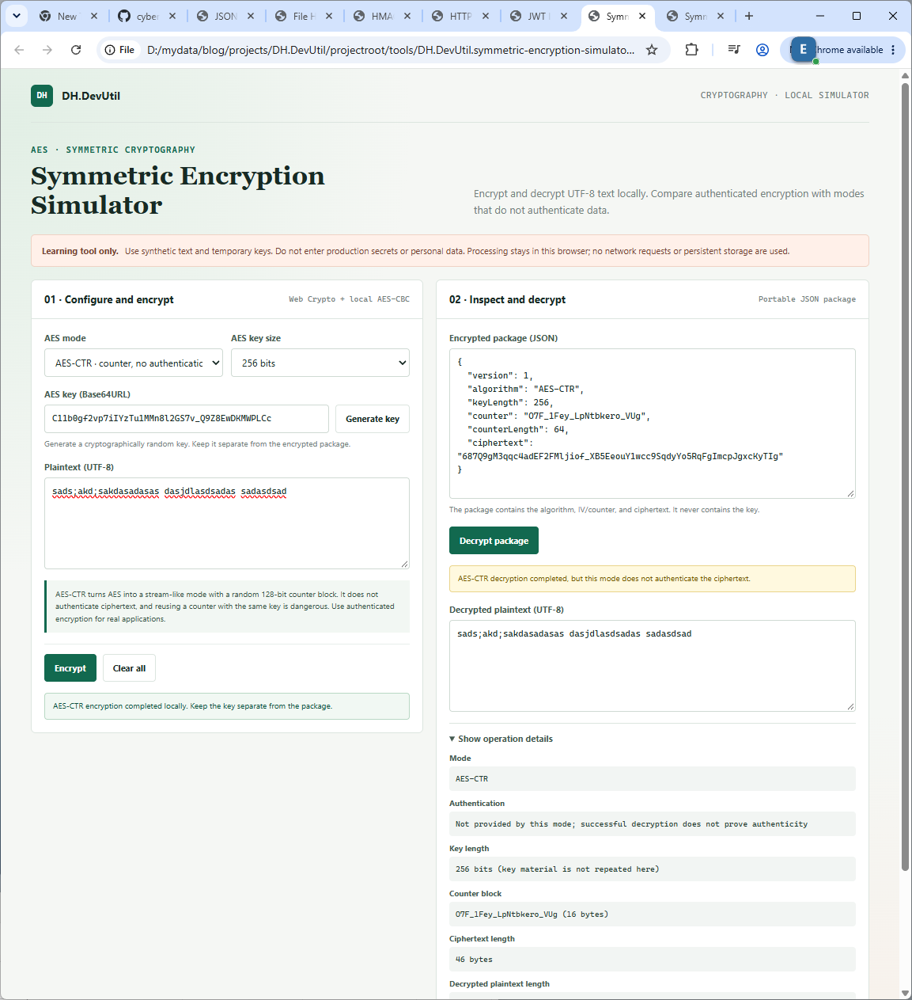

# DH.DevUtil

DH.DevUtil은 일상적인 개발 작업에 사용하는 가벼운 유틸리티 모음입니다. 각 도구는 설치나 외부 라이브러리 없이 최신 브라우저에서 실행되는 독립 HTML 파일입니다.

[English](./README.md)

## 도구 목록

| 도구 | 기능 | 온라인 실행 | 소스 | 안내 |
|---|---|---|---|---|
| JSON Parser | JSON 검증·탐색·형식화·축약, Base64 값 확인 및 내장 이미지 미리보기 | [실행 (Ctrl+클릭으로 새 탭)](https://cyberkdh.github.io/DH.DevUtil/tools/DH.DevUtil.json.html) | [소스 보기](./tools/DH.DevUtil.json.html) | [사용 안내](./docs/JSON_PARSER.ko.md) |
| File Hash Calculator | 로컬 파일의 암호학적 해시, 체크섬 및 비암호학 해시 계산 | [실행 (Ctrl+클릭으로 새 탭)](https://cyberkdh.github.io/DH.DevUtil/tools/DH.DevUtil.hash.html) | [소스 보기](./tools/DH.DevUtil.hash.html) | [알고리즘 및 사용 안내](./docs/HASH_ALGORITHMS.ko.md) |
| HMAC Simulator (Base) | HMAC 태그를 계산·검증하고 Client → 전달 데이터 → Server 흐름을 확인 | [실행 (Ctrl+클릭으로 새 탭)](https://cyberkdh.github.io/DH.DevUtil/tools/DH.DevUtil.hmac-simulator-base.html) | [소스 보기](./tools/DH.DevUtil.hmac-simulator-base.html) | [사용 안내](./docs/HMAC_SIMULATOR.ko.md) |
| HTTP Digest Authentication Simulator | RFC 7616 challenge, Digest response, Server 검증 흐름 시뮬레이션 | [실행 (Ctrl+클릭으로 새 탭)](https://cyberkdh.github.io/DH.DevUtil/tools/DH.DevUtil.http-digest-auth-simulator.html) | [소스 보기](./tools/DH.DevUtil.http-digest-auth-simulator.html) | [사용 안내](./docs/HTTP_DIGEST_AUTH_SIMULATOR.ko.md) |
| JWT Inspector | 테스트 JWT 생성(HS256), 일반 JWT 파싱 및 HS256 서명 검증 | [실행 (Ctrl+클릭으로 새 탭)](https://cyberkdh.github.io/DH.DevUtil/tools/DH.DevUtil.jwt-inspector.html) | [소스 보기](./tools/DH.DevUtil.jwt-inspector.html) | [사용 안내](./docs/JWT_INSPECTOR.ko.md) |
| Number Notation Converter | `1.23457E+15` 같은 E 표기를 정확한 일반 표기, 천 단위 구분, 공학 표기, SI 접두어, 한국어 단위로 바꾸고 double·float32 저장값 확인 | [실행 (Ctrl+클릭으로 새 탭)](https://cyberkdh.github.io/DH.DevUtil/tools/DH.DevUtil.number-notation.html) | [소스 보기](./tools/DH.DevUtil.number-notation.html) | [사용 안내](./docs/NUMBER_NOTATION_CONVERTER.ko.md) |
| Symmetric Encryption Simulator (Base) | AES, ARIA, 3DES, DES(ECB/CBC)와 padding 선택, 공유 Key/IV, 고정 IV로 같은 결과를 재현하며 대칭 암호화 학습 | [실행 (Ctrl+클릭으로 새 탭)](https://cyberkdh.github.io/DH.DevUtil/tools/DH.DevUtil.symmetric-encryption-simulator-base.html) | [소스 보기](./tools/DH.DevUtil.symmetric-encryption-simulator-base.html) | [사용 안내](./docs/SYMMETRIC_ENCRYPTION_SIMULATOR_BASE.ko.md) |
| Symmetric Encryption Simulator | AES-GCM/CBC/CTR 암복호화와 CBC padding 비교 | [실행 (Ctrl+클릭으로 새 탭)](https://cyberkdh.github.io/DH.DevUtil/tools/DH.DevUtil.symmetric-encryption-simulator.html) | [소스 보기](./tools/DH.DevUtil.symmetric-encryption-simulator.html) | [사용 안내](./docs/SYMMETRIC_ENCRYPTION_SIMULATOR.ko.md) |

온라인 데모는 GitHub Pages에서 정적 HTML 도구를 실행합니다. 소스 링크는 GitHub에서 HTML 코드를 보여줄 뿐 도구를 실행하지 않습니다. 오프라인으로 사용하려면 저장소를 clone하거나 도구 HTML 파일을 내려받아 브라우저에서 여세요.

## HTTP Digest Authentication Simulator 미리보기

RFC 7616 challenge 생성, Client response 계산, Server 검증과 계산 상세를 한 화면에서 확인할 수 있습니다. 자세한 기능과 사용 방법은 [HTTP Digest Authentication Simulator 안내](./docs/HTTP_DIGEST_AUTH_SIMULATOR.ko.md)를 참고하세요.

## JWT Inspector 미리보기

테스트 JWT 생성, compact token 파싱, HS256 서명 검증과 상세 정보를 확인할 수 있습니다. 자세한 기능과 사용 방법은 [JWT Inspector 안내](./docs/JWT_INSPECTOR.ko.md)를 참고하세요.

## Number Notation Converter 미리보기

`1.23457E+15` 같은 E 표기를 정확한 10진 변환으로 읽기 쉬운 숫자로 바꾸고, double·float32에 실제로 저장되는 값을 확인할 수 있습니다. 자세한 기능과 사용 방법은 [Number Notation Converter 안내](./docs/NUMBER_NOTATION_CONVERTER.ko.md)를 참고하세요.

## Symmetric Encryption Simulator (Base) 미리보기

가운데의 공유 키·IV 하나로 Encrypt와 Decrypt를 수행하고, ECB와 CBC를 블록 단위로 비교할 수 있습니다. 자세한 기능과 사용 방법은 [Symmetric Encryption Simulator (Base) 안내](./docs/SYMMETRIC_ENCRYPTION_SIMULATOR_BASE.ko.md)를 참고하세요.

## Symmetric Encryption Simulator 미리보기

AES-GCM, AES-CBC, AES-CTR로 암호화하고, 키를 제외한 JSON 패키지를 만들어 복호화와 처리 상세를 확인할 수 있습니다. 자세한 기능과 사용 방법은 [Symmetric Encryption Simulator 안내](./docs/SYMMETRIC_ENCRYPTION_SIMULATOR.ko.md)를 참고하세요.

## 중요 안내

- 도구 입력은 현재 브라우저에서 처리하며 DH.DevUtil 서버로 업로드하지 않습니다.
- HMAC Simulator (Base)는 키에서 파생된 중간값을 의도적으로 표시하므로 운영 비밀 키나 자격 증명을 입력하지 마세요.
- HTTP Digest Authentication Simulator는 password에서 파생된 Digest 및 계산 과정을 표시하므로 운영 password나 자격 증명을 입력하지 마세요.
- JWT Inspector는 claims와 키를 로컬에서 처리합니다. 운영 JWT, 개인정보가 든 토큰 또는 production signing key를 입력하지 마세요.
- Symmetric Encryption Simulator (Base)는 키와 중간값을 표시하고 기본적으로 고정 IV를 사용하며, DES/3DES는 학습용으로만 포함합니다. 운영 키나 개인정보를 입력하지 마세요.
- Symmetric Encryption Simulator는 로컬 AES 키와 메시지를 처리합니다. 운영 키나 개인정보를 입력하지 마세요. AES-CBC와 AES-CTR은 암호문 무결성(authentication)을 보장하지 않습니다.
- 레거시 해시와 비암호학 체크섬은 악의적인 변경에 대한 보안 용도로 적합하지 않습니다. [해시 보안 안내](./docs/HASH_ALGORITHMS.ko.md)를 확인하세요.
- 내려받은 사본을 실행하거나 다른 페이지에 도구를 삽입할 때는 도구 파일의 출처와 브라우저 환경을 신뢰할 수 있는지 확인하세요.

## 시작하기

1. 도구 목록에서 **실행**을 선택해 온라인 데모를 사용하거나, 오프라인 사용을 위해 저장소를 clone하거나 HTML 파일을 내려받습니다.
2. 해당 도구의 안내 문서를 참고합니다.

## 최근 변경 사항

미출시 변경과 정식 버전 이력은 [변경 이력](./CHANGELOG.ko.md)을 참고하세요.

## 프로젝트 문서

- [기여 안내](./CONTRIBUTING.ko.md)
- [보안 정책](./SECURITY.ko.md)
- [MIT License](./LICENSE)
