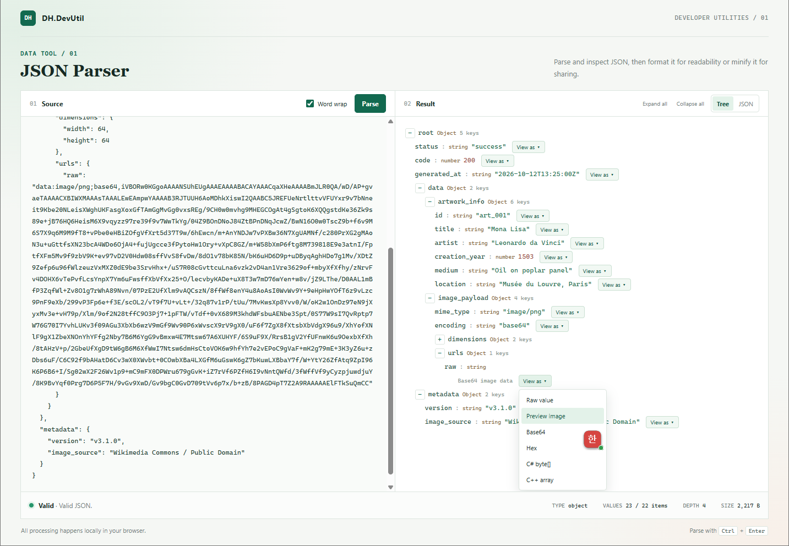
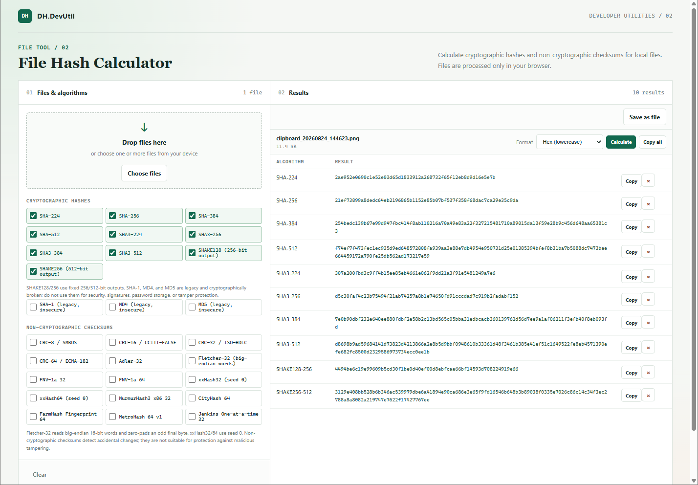

# DH.DevUtil

DH.DevUtil은 개발할 때 자주 쓰는 작은 유틸리티를 모은 프로젝트입니다. 각 도구는 빌드나 패키지 설치 없이 브라우저에서 바로 실행되는 단일 HTML 파일로 제공됩니다.

[English](./README.md)

## 도구

| 도구 | 설명 |
|---|---|
| [JSON Parser](./tools/DH.DevUtil.json.html) | JSON을 검증하고 트리 또는 원문으로 탐색합니다. 형식화, 축약, Base64 디코딩 및 이미지 미리보기를 지원합니다. 자세한 내용은 [JSON Parser 안내](./docs/JSON_PARSER.ko.md)를 참고하세요. |
| [File Hash Calculator](./tools/DH.DevUtil.hash.html) | 로컬 파일의 암호학적 해시, 체크섬 및 비암호학 해시를 계산합니다. 파일별 결과 누적, 복사, 삭제, 출력 형식 선택 및 다운로드를 지원합니다. [알고리즘 안내](./docs/HASH_ALGORITHMS.ko.md)를 참고하세요. |

## 스크린샷

**JSON Parser**

**File Hash Calculator**

## 시작하기

1. 저장소를 clone하거나 사용할 도구의 HTML 파일을 내려받습니다.
2. 브라우저에서 `tools` 폴더의 HTML 파일을 엽니다.
3. JSON Parser에서는 JSON 텍스트를 붙여 넣고 `Parse`를 선택합니다. File Hash Calculator에서는 파일을 선택하거나 drop합니다.

도구는 HTML 안에 CSS와 JavaScript를 포함하며 외부 JavaScript 라이브러리나 런타임을 요구하지 않습니다.

### JSON Parser

- JSON 입력을 검증하고 구문 오류를 표시합니다.
- 접고 펼칠 수 있는 **Tree** 또는 **JSON** 텍스트 보기에서 객체와 배열을 탐색합니다.
- 2칸 또는 4칸 들여쓰기로 형식화(Format)하거나 축약(Minify)하고 결과를 복사할 수 있습니다.
- root type, 값/멤버 수, 깊이(depth), 입력 크기를 확인할 수 있습니다.
- Base64 데이터를 Hex, C# `byte[]`, 또는 C++ byte array로 볼 수 있습니다. 인식 가능한 Base64 이미지는 미리보기와 다운로드를 지원합니다.

## 개인정보 및 로컬 처리

File Hash Calculator는 선택한 파일을 현재 브라우저 안에서 처리합니다. 이 저장소의 도구는 파일 업로드나 분석 텔레메트리(telemetry)를 구현하지 않습니다. 해시 계산 중 파일 데이터는 브라우저 메모리에서 처리됩니다.

내려받은 파일을 실행하거나 신뢰할 수 없는 환경에서 도구를 사용할 때는 HTML의 출처와 내용을 먼저 확인하세요. 도구를 다른 웹 페이지에 삽입하는 경우에는 해당 페이지와 스크립트도 신뢰할 수 있어야 합니다.

## 해시 도구 보안 주의

- SHA-1, MD4, MD5는 레거시(legacy) 호환 목적으로만 제공됩니다. 새 보안 설계, 전자서명, 비밀번호 저장 또는 악의적 변조 방지에 사용하지 마세요.
- CRC, Adler-32, Fletcher-32 및 비암호학(non-cryptographic) 해시는 우발적인 오류 검출이나 식별용이며 공격자에 대한 인증/무결성을 제공하지 않습니다.
- SHAKE128/256 출력 길이는 각각 256-bit/512-bit로 고정되어 있습니다.
- HMAC 및 비밀 키(secret key)를 받는 keyed hash는 파일 해시 도구에 포함되어 있지 않습니다.

## 지원 환경

최신 데스크톱 브라우저 사용을 권장합니다. SHA-256/384/512는 브라우저의 Web Crypto API를 사용하므로 해당 API를 제공하는 브라우저 컨텍스트에서 실행해야 합니다. 매우 큰 파일은 전체 데이터를 메모리에 읽으므로 메모리 사용량이 커질 수 있습니다.

## 라이선스

MIT License를 따릅니다. 자세한 내용은 [LICENSE](./LICENSE)를 참고하세요.
