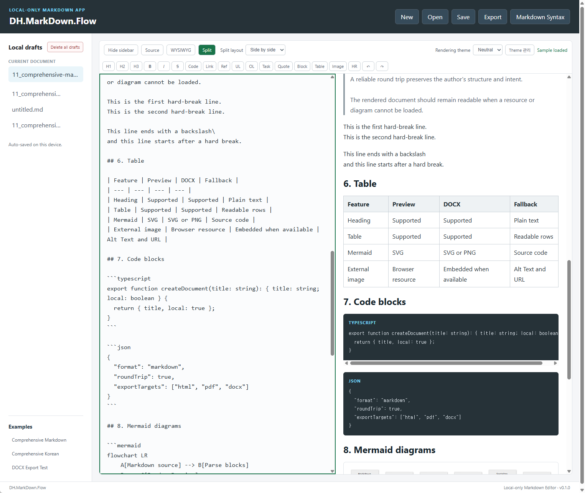

# DH.DevUtil

DH.DevUtil is a collection of lightweight utilities for everyday development tasks. Each tool is a standalone HTML file that runs in a modern browser without installation or external libraries. The exception is DH.MarkDown.Flow, a prebuilt app that bundles its third-party libraries.

[한국어](./README.ko.md)

## Tools

| Tool | What it does | Live demo | Source | Guide |
|---|---|---|---|---|
| JSON Parser | Validate, explore, format, and minify JSON. Inspect Base64 values and preview embedded images. | [Run (Ctrl-click for a new tab)](https://cyberkdh.github.io/DH.DevUtil/tools/DH.DevUtil.json.html) | [View source](./tools/DH.DevUtil.json.html) | [Guide](./docs/JSON_PARSER.md) |
| File Hash Calculator | Calculate cryptographic hashes, checksums, and non-cryptographic hashes for local files. | [Run (Ctrl-click for a new tab)](https://cyberkdh.github.io/DH.DevUtil/tools/DH.DevUtil.hash.html) | [View source](./tools/DH.DevUtil.hash.html) | [Algorithms and guide](./docs/HASH_ALGORITHMS.md) |
| HMAC Simulator (Base) | Calculate and verify HMAC tags and explore the Client → in-transit data → Server flow. | [Run (Ctrl-click for a new tab)](https://cyberkdh.github.io/DH.DevUtil/tools/DH.DevUtil.hmac-simulator-base.html) | [View source](./tools/DH.DevUtil.hmac-simulator-base.html) | [Guide](./docs/HMAC_SIMULATOR.md) |
| HTTP Digest Authentication Simulator | Simulate RFC 7616 challenges, Digest responses, and server verification. | [Run (Ctrl-click for a new tab)](https://cyberkdh.github.io/DH.DevUtil/tools/DH.DevUtil.http-digest-auth-simulator.html) | [View source](./tools/DH.DevUtil.http-digest-auth-simulator.html) | [Guide](./docs/HTTP_DIGEST_AUTH_SIMULATOR.md) |
| JWT Inspector | Generate demo JWTs with HS256, parse compact JWTs, and verify HS256 signatures. | [Run (Ctrl-click for a new tab)](https://cyberkdh.github.io/DH.DevUtil/tools/DH.DevUtil.jwt-inspector.html) | [View source](./tools/DH.DevUtil.jwt-inspector.html) | [Guide](./docs/JWT_INSPECTOR.md) |
| Number Notation Converter | Turn E notation such as `1.23457E+15` into exact plain, grouped, engineering, SI, and Korean-unit forms, and see what a double or float32 stores. | [Run (Ctrl-click for a new tab)](https://cyberkdh.github.io/DH.DevUtil/tools/DH.DevUtil.number-notation.html) | [View source](./tools/DH.DevUtil.number-notation.html) | [Guide](./docs/NUMBER_NOTATION_CONVERTER.md) |
| Symmetric Encryption Simulator (Base) | Learn symmetric encryption with AES, ARIA, 3DES, and DES in ECB/CBC mode, selectable padding, one shared key and IV, and a fixed IV for reproducible ciphertext. | [Run (Ctrl-click for a new tab)](https://cyberkdh.github.io/DH.DevUtil/tools/DH.DevUtil.symmetric-encryption-simulator-base.html) | [View source](./tools/DH.DevUtil.symmetric-encryption-simulator-base.html) | [Guide](./docs/SYMMETRIC_ENCRYPTION_SIMULATOR_BASE.md) |
| Symmetric Encryption Simulator | Encrypt/decrypt with AES-GCM/CBC/CTR and compare CBC padding schemes. | [Run (Ctrl-click for a new tab)](https://cyberkdh.github.io/DH.DevUtil/tools/DH.DevUtil.symmetric-encryption-simulator.html) | [View source](./tools/DH.DevUtil.symmetric-encryption-simulator.html) | [Guide](./docs/SYMMETRIC_ENCRYPTION_SIMULATOR.md) |
| DH.MarkDown.Flow | Local-first Markdown editor with Source, WYSIWYG, and Split modes, Mermaid diagrams, and Markdown/HTML/PDF/Word export. | [Run (Ctrl-click for a new tab)](https://cyberkdh.github.io/DH.DevUtil/tools/DH.MarkDown.Flow/index.html) [Download offline version (right-click → Save link as)](https://raw.githubusercontent.com/cyberkdh/DH.DevUtil/main/tools/DH.MarkDown.Flow/index_local.html) | [View files](./tools/DH.MarkDown.Flow/) | [Guide](./docs/MARKDOWN_FLOW.md) |

Live demos run the static HTML tools on GitHub Pages. The source links open the HTML files in GitHub's code viewer; they do not run the tools. To use a tool offline, clone the repository or download its HTML file, then open it in a browser. For DH.MarkDown.Flow, open `index_local.html`; `index.html` needs a web server.

## HTTP Digest Authentication Simulator preview

Explore the RFC 7616 challenge, Client response calculation, Server verification, and calculation details in one screen. See the [HTTP Digest Authentication Simulator guide](./docs/HTTP_DIGEST_AUTH_SIMULATOR.md) for features and usage.

## JWT Inspector preview

Generate demo JWTs, parse compact tokens, and inspect HS256 signature verification details. See the [JWT Inspector guide](./docs/JWT_INSPECTOR.md) for features and usage.

## Number Notation Converter preview

Turn E notation such as `1.23457E+15` into readable numbers with exact decimal conversion, and see what a double or float32 actually stores. See the [Number Notation Converter guide](./docs/NUMBER_NOTATION_CONVERTER.md) for features and usage.

## Symmetric Encryption Simulator (Base) preview

Encrypt and Decrypt with one shared key and IV in the middle, then compare ECB and CBC block by block. See the [Symmetric Encryption Simulator (Base) guide](./docs/SYMMETRIC_ENCRYPTION_SIMULATOR_BASE.md) for features and usage.

## Symmetric Encryption Simulator preview

Encrypt with AES-GCM, AES-CBC, or AES-CTR, export a JSON package without the key, and decrypt it with operation details. See the [Symmetric Encryption Simulator guide](./docs/SYMMETRIC_ENCRYPTION_SIMULATOR.md) for features and usage.

## DH.MarkDown.Flow preview

Edit Markdown in Source, WYSIWYG, or Split mode, preview Mermaid diagrams, and export to Markdown, HTML, PDF, or Word. See the [DH.MarkDown.Flow guide](./docs/MARKDOWN_FLOW.md) for features and usage.

## Important

- Tools process input in the current browser and do not upload it to a DH.DevUtil server.
- Do not enter production secrets or credentials in HMAC Simulator (Base). It intentionally displays key-derived intermediate values.
- Do not enter production passwords or credentials in HTTP Digest Authentication Simulator. Digest responses and calculation steps contain password-derived values.
- Do not enter production JWTs, personally identifiable claims, or production signing keys in JWT Inspector.
- Do not enter production keys or personal data in Symmetric Encryption Simulator (Base). It displays keys and intermediate values, uses a fixed IV by default, and includes DES/3DES for learning only.
- Do not enter production keys or personal data in Symmetric Encryption Simulator. AES-CBC and AES-CTR do not authenticate ciphertext.
- Legacy hashes and non-cryptographic checksums are not suitable for security against malicious changes. See the [hash security notes](./docs/HASH_ALGORITHMS.md).
- DH.MarkDown.Flow stores drafts in the browser's local storage and loads external images referenced by a document from the network. It bundles third-party libraries listed in its [third-party notices](./tools/DH.MarkDown.Flow/THIRD_PARTY_NOTICES.md).
- When using a downloaded copy or embedding a tool in another page, verify and trust its source and the surrounding browser environment.

## Getting Started

1. Select **Run** in the tool catalog to use a live demo, or clone this repository/download the HTML file for offline use.
2. Follow the corresponding tool guide.

## Recent Changes

See the [changelog](./CHANGELOG.md) for unreleased updates and release history.

## Project

- [Contributing](./CONTRIBUTING.md)
- [Security policy](./SECURITY.md)
- [MIT License](./LICENSE)
