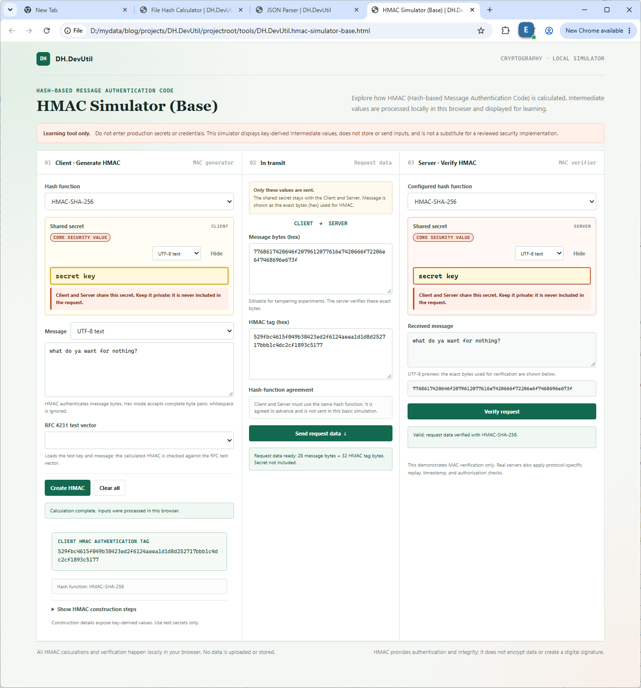

# HMAC 시뮬레이터 (Base)

[English](./HMAC_SIMULATOR.md)

HMAC 시뮬레이터 (Base)는 메시지 바이트에 대한 HMAC을 계산하고, 생성 과정을 단계별로 확인할 수 있는 독립 학습 도구입니다.



스크린샷에는 설명을 위한 예제 값만 사용했습니다. 실제 도구에서는 Client와 Server의 shared secret 입력이 기본적으로 숨겨집니다.

## 기능

- HMAC-SHA-256, HMAC-SHA-384, HMAC-SHA-512 계산
- 키와 메시지를 UTF-8 텍스트 또는 16진수 바이트(Hex bytes)로 입력
- 키 정규화, `K0`, `ipad`, 내부 digest, `opad`, 최종 HMAC 확인
- Client → 중간 전달 데이터 → Server 흐름을 세 개의 패널로 구분
- 정확한 메시지 바이트(Hex)와 HMAC 인증 태그(authentication tag)만 중간 패널로 전달. 공유 secret은 전달되지 않음
- Server의 해시 함수와 공유 secret을 독립 설정한 뒤 브라우저 Web Crypto API로 검증
- Server 패널에 수신 메시지를 표시하고, UTF-8 미리보기와 검증에 사용한 원본 바이트(Hex)를 함께 확인
- 전달 중인 바이트/태그, Server 키 또는 해시 함수를 변경해 검증 실패 실험
- RFC 4231 테스트 벡터를 선택하면 테스트용 키와 메시지를 불러오고, 계산된 HMAC을 RFC 기대값과 비교
- shared secret을 핵심 보안 값(Core security value)으로 시각적으로 강조하고, Client/Server가 보호해야 하며 요청에 포함하지 않는다는 점을 표시
- Server의 shared secret 입력도 동일하게 강조하며, Client 값과 별도 설정되지만 검증을 위해 일치해야 함을 안내
- Client와 Server의 shared secret은 모두 기본적으로 숨겨지며, 각 **Show/Hide** 버튼으로 개별 표시하거나 숨길 수 있음
- 네트워크 요청, 외부 라이브러리, 영구 저장 없이 현재 브라우저에서 처리
- 입력값 및 화면에 표시된 중간값 지우기

## 사용 방법

1. 최신 브라우저에서 [`DH.DevUtil.hmac-simulator-base.html`](../tools/DH.DevUtil.hmac-simulator-base.html)을 엽니다.
2. 해시 함수(hash function)와 키·메시지 입력 인코딩을 선택합니다.
3. 예제 값을 입력하거나 RFC 4231 테스트 벡터를 선택합니다.
4. Client에서 **Create HMAC**을 눌러 메시지 인증 코드(message authentication code)를 계산합니다. **Show HMAC construction steps**를 열면 중간값을 확인할 수 있습니다.
5. **Send request data**를 누릅니다. 가운데 패널에 메시지의 실제 바이트를 Hex로 표시하고 HMAC 태그를 전달합니다. secret은 전달하지 않습니다.
6. Server에서 공유 secret과 해시 함수(hash function)를 각각 입력·선택하고 **Verify request**를 누릅니다. Server 패널에서 수신 메시지의 UTF-8 미리보기와 실제 검증에 사용된 바이트(Hex)를 확인할 수 있습니다.
7. 전달 데이터의 메시지/태그 또는 Server 키/해시 함수를 바꿔 다시 검증하면 실패를 확인할 수 있습니다.
8. **Clear all**을 눌러 Client, 중간 전달 값, Server 입력과 결과를 지웁니다.

Hex 입력은 바이트 사이 공백을 허용하지만, 16진수 숫자는 완전한 두 자리씩 입력해야 합니다. 계산상 빈 키와 빈 메시지도 허용됩니다.
시뮬레이터의 요청 패널은 메시지 바이트를 Hex로 표시하며, Server는 HMAC 검증 전에 정확히 같은 바이트로 복원합니다. Server에는 유효한 UTF-8이면 텍스트 미리보기를 표시하고, UTF-8이 아니면 디코딩 불가 안내와 함께 정확한 Hex 바이트를 표시합니다. Client와 Server의 해시 함수 설정은 독립적이며 일치해야 합니다. 기본 패킷에는 해시 함수가 포함되지 않고 사전 합의된 것으로 가정합니다.

## HMAC 생성 과정

블록 크기가 `B`인 해시 함수 `H`에 대해, 먼저 키를 `K0`로 정규화합니다. 키가 `B`보다 길면 해시하고, 그렇지 않으면 `B` 바이트가 되도록 0 바이트를 덧붙입니다. HMAC 결과는 다음과 같습니다.

```text
H((K0 XOR opad) || H((K0 XOR ipad) || message))
```

`ipad`는 블록 크기만큼 반복한 `0x36` 바이트이고, `opad`는 `0x5c` 바이트입니다. SHA-256의 블록 크기는 64바이트이며 SHA-384와 SHA-512는 128바이트입니다.

해시 계산에는 브라우저의 Web Crypto API를 사용합니다. 각 단계를 표시하기 위한 중간 구성은 페이지 내부 JavaScript에서 처리합니다.

## 보안 주의

이 도구는 학습용 시뮬레이터이며 운영 키 관리 도구나 검토된 암호 구현을 대체하지 않습니다. 단계 표시를 위해 `K0`, `ipad`, `opad`를 의도적으로 노출하며, 이는 키에서 파생된 값을 드러내고 실질 키를 노출할 수 있습니다. **운영 비밀 키, 자격 증명 또는 민감한 메시지를 입력하지 마세요.** 페이지는 입력값을 저장하거나 전송하지 않지만, 브라우저 확장 프로그램, 주입된 스크립트 또는 수정된 페이지는 값에 접근할 수 있습니다.

RFC 4231 표기는 공유 키만이 아니라 테스트 키, 메시지, 기대 HMAC 값으로 구성된 테스트 벡터를 가리킵니다. 따라서 RFC 4231 표시는 특정 입력 키 옆이 아니라 테스트 벡터 선택기 옆에 있습니다. 가운데 패널은 로컬 전달 시뮬레이션이며 실제 네트워크 요청을 보내지 않습니다. 검증은 로컬 MAC 검증만 표현합니다. timestamp freshness, nonce 재사용 추적, client 권한, 네트워크 전송, 서버 측 secret 조회는 다루지 않습니다. HMAC은 메시지 인증과 무결성을 제공하지만 암호화나 전자서명(digital signature)은 제공하지 않습니다. 비밀번호 해싱, 키 저장, 운영 서버 인증 기능은 제공하지 않습니다.
