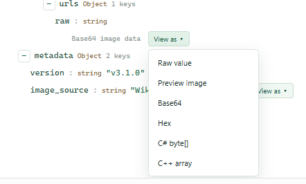

# JSON Parser Guide

[JSON Parser](../tools/DH.DevUtil.json.html) is a standalone HTML tool that runs in your browser without installation.

[한국어 안내](./JSON_PARSER.ko.md)

## Getting Started

1. Open the HTML file in a web browser.
2. Paste JSON text into the **Source** input.
3. Select `Parse` to validate the JSON syntax and display the result.
4. If you edit the input, run `Parse` again to refresh the result.

Empty or invalid input is reported in the status area. For valid JSON, the tool displays the root type, value/member counts, depth, and input size.

## Explore and Transform Results

- **Tree**: Displays objects and arrays hierarchically. Expand or collapse individual nodes, or use `Expand all` and `Collapse all` for the entire tree.
- **JSON**: Displays the parsed value as JSON text.
- **Format**: Formats JSON with a choice of 2- or 4-space indentation.
- **Minify**: Removes unnecessary whitespace and line breaks.
- **Copy result**: Copies the current transformed result to the clipboard.
- Word wrap can be toggled for the input and raw values. Long scalar values may be truncated in the tree; use `View as` → `Raw value` to inspect and copy the complete value.

## Base64 and Image Preview

When a value is recognized as Base64, the `View as` menu lets you inspect and copy these representations:

- Base64
- Hex
- C# `byte[]` initializer
- C++ `unsigned char` array

Base64 values without trailing `=` padding are also recognized. If a `data:...;base64,` value cannot be decoded, the `View as` menu shows the reason, such as invalid length, misplaced padding, or unexpected characters.

Recognized Base64 image data can be opened with `Preview image`. The preview shows the image dimensions and MIME type and allows downloading the image. The tool does not fetch arbitrary external URLs.

## Processing and Privacy

JSON input is parsed in the browser tab. The tool does not send input to a server and does not use external script libraries. For sensitive JSON, use a trusted browser and a local copy of the HTML, and ensure that browser extensions or the host page do not collect the input.

## Limitations

- Syntax validation follows the browser's standard `JSON.parse` behavior. JavaScript object literals, comments, and trailing commas are not valid JSON and are rejected.
- There is no file upload or JSON file import UI. Paste JSON text into the input instead.
- Image preview is limited to recognized, decodable image data in Base64 values. Corrupt or unsupported image data is reported instead of being shown as a successful preview.
