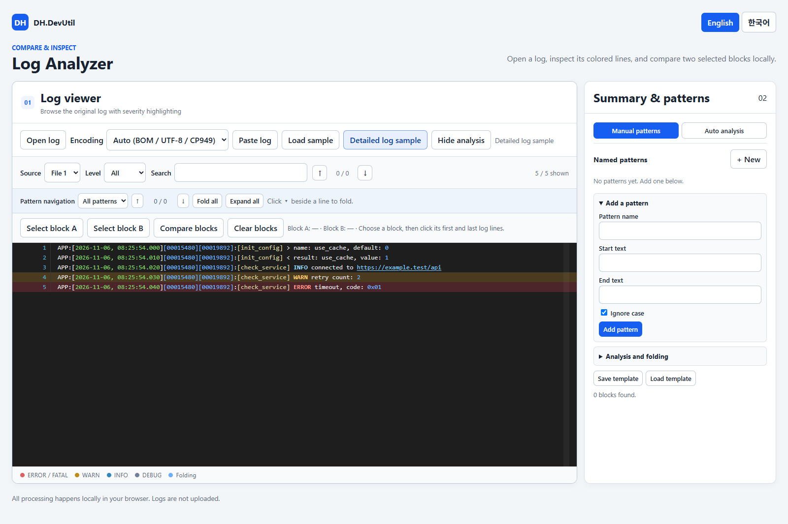

# Log Analyzer

[English](./LOG_ANALYZER.md)

독립 실행형 HTML에서 로그 하나를 분석하고 선택한 두 구간을 비교합니다.

## 화면 미리보기

## 기능

- 로그 파일 하나를 뷰어에 끌어놓거나 선택하고 텍스트를 직접 붙여넣을 수 있습니다.
- UTF-8, CP949/EUC-KR, UTF-16 LE/BE, Windows-1252 인코딩을 선택할 수 있습니다. 선택을 바꾸면 파일을 로컬에서 다시 읽습니다.
- 큰 스크롤 로그 뷰어에서 줄 번호, 심각도별 색상, 검색, 레벨 필터를 사용합니다.
- 로그 뷰어와 분석 패널의 높이는 브라우저 창에 맞춰 함께 조정됩니다. 작은 화면에서는 버튼과 최소 로그 표시 높이를 위해 페이지 스크롤이 생길 수 있습니다.
- 로그 뷰어는 브라우저 너비에 맞춰 확장되며 분석 패널을 숨기면 가로 공간을 더 넓게 사용합니다.
- 날짜·시간, 대괄호 숫자 ID와 함수명, 숫자, 16진수, URL을 구분해 표시하고 클릭한 줄을 강조합니다. 상세 로그 샘플에서 색상을 확인할 수 있습니다.
- 검색하면 주변 줄을 유지하면서 본문의 일치 부분을 강조하고, 오른쪽 위치 표시줄에 검색 위치를 표시합니다. 화살표 또는 Enter/Shift+Enter로 결과를 이동합니다.
- 화면에 보이는 줄만 렌더링해 큰 로그에서도 스크롤과 검색 부담을 줄입니다.
- 애플리케이션, Apache/Nginx, IIS W3C, JSON Lines, key=value, stack trace 샘플을 제공합니다.
- 오른쪽의 요약·패턴 패널은 기본으로 표시되며 숨길 수 있습니다. 비슷한 줄을 휴리스틱(heuristic) 패턴으로 묶고 접기·펼치기, 검색 및 레벨 필터를 사용합니다.
- 오른쪽 패널의 **수동 패턴**과 **자동 분석** 탭을 분리했습니다. 자동 분석은 비슷한 줄을 추정해 묶고, 수동 패턴은 시작·끝 구간의 접기를 제공합니다.
- 시작·끝 문구를 가진 이름별 패턴을 추가·수정·삭제하고 일치 구간을 로그에서 접거나 펼칩니다. 패턴 설정은 JSON 템플릿으로 저장하고 불러올 수 있습니다.
- 패턴 목록에서 각 시작·끝 문구와 대소문자 옵션을 바로 확인하고 수정할 수 있습니다. 수정 사항을 파일로 보관하려면 **템플릿 저장**을 다시 누릅니다.
- 로그 위의 패턴 찾기에서 패턴을 선택하고 이전·다음 구간으로 이동할 수 있습니다. 분석 패널의 패턴별 **찾기**도 첫 구간으로 이동하며, 시작 줄에는 접기 표시와 패턴 이름이 나타납니다.
- 패턴의 **찾기**를 누른 뒤 해당 패턴 카드 안의 **이전/다음**으로 계속 이동할 수 있으며 뷰어 위의 위치 표시와 동기화됩니다. 패턴 편집과 추가 분석 작업은 접어서 정리할 수 있습니다.
- 패턴이 하나이고 구간이 발견되면 결과 목록이 자동으로 열립니다. 여러 패턴이 있으면 각 카드의 **찾기**로 목록을 열고 **접기**로 닫습니다. 목록에서 줄 범위와 인식 가능한 시간을 보고 기준 구간을 지정해 다른 구간과 비교합니다. 원본 동일, 앞부분 시간·ID 제외 동일, 차이, 요약 생략을 구분하며 **더 보기**로 나머지 구간을 확인합니다.
- 비교 창에서 변경 줄만 보기, 변경 텍스트 강조, 이전·다음 차이 이동을 제공합니다. 각 줄이 아닌 좌우 패널마다 하나의 스크롤 영역을 사용하고 가능한 범위에서 가로·세로 스크롤을 동기화합니다.
- 로그의 두 구간에서 첫 줄과 마지막 줄을 선택해 별도 창에서 좌우 비교합니다. 원본, 앞부분 시간·ID 숨김, 정규화 치환값 표시와 결과 저장을 지원합니다.
- 영어·한국어 UI를 전환합니다.

## 사용 방법

1. [Log Analyzer](../tools/DH.DevUtil.log-analyzer.html)를 열고 로그 파일 하나 또는 샘플을 불러옵니다.
2. 필요할 때 오른쪽 **요약 · 패턴** 패널을 엽니다.
3. **블록 A 선택**을 누르고 첫 줄과 마지막 줄을 클릭한 뒤 블록 B도 선택합니다.
4. **블록 비교**를 누르면 비교 창이 브라우저 크기에 맞춰 열리고 창 크기 변경에 따라 조절됩니다. 원본이 기본으로 보이되 인식된 앞부분 시간·ID는 비교에서 무시합니다. **표시**에서 시간·ID를 숨기거나 정규화 치환값을 볼 수 있으며, **앞부분 시간 / ID 무시**를 해제하면 정규화하지 않는 모드에서 시간·ID도 비교합니다.
5. 접기(folding)를 사용하려면 분석 패널에서 이름, 시작 문구와 끝 문구를 추가하고 로그 줄 번호 옆 표시를 누릅니다. 등록하면 현재 로그를 자동 분석하며, **Reanalyze**로 다시 실행할 수 있습니다. 다시 분석하면 접힌 구간이 펼쳐집니다. 뷰어 위의 **패턴 찾기**로 이전·다음 구간을 이동하고, 패턴 설정은 **템플릿 저장/불러오기**로 재사용합니다.
6. 자동으로 열린 구간 목록을 확인하거나, 여러 패턴이 있으면 해당 패턴의 **찾기**를 누릅니다. **기준 지정** 후 다른 구간의 **비교**를 누르고 원하는 표시·비교 방식을 선택합니다.

## 제한 사항

- 비교 창은 시간과 숫자 헤더 ID가 인식된 줄 수와 인식되지 않은 줄 수를 표시합니다. 대괄호·줄 시작 ISO 시간과 일반적인 syslog 헤더를 감지합니다. 연속된 대괄호 숫자 ID 또는 긴 단일 숫자 ID를 헤더로 취급하며 `[500]`처럼 짧은 단일 숫자는 본문에 남깁니다. 인식하지 못한 줄은 원본 그대로 비교합니다. 형식 기반 추정이므로 감지 결과를 확인하고 해당 값이 중요하면 무시 체크박스를 해제하세요.
- 패턴은 일반적인 timestamp, IPv4, UUID, 숫자 치환을 기반으로 추정하므로 서로 다른 로그가 함께 묶이거나 비슷한 로그가 나뉠 수 있습니다.
- IIS 파서는 `#Fields:` 헤더가 필요하고 access log는 일반적인 combined 형식을 사용합니다. Stack trace는 이벤트 전체가 아닌 줄 단위로 비교합니다.
- 자동 감지는 UTF-8/UTF-16 BOM을 먼저 확인하고 유효한 UTF-8, CP949/EUC-KR 순으로 시도합니다. 휴리스틱이므로 ASCII나 다른 인코딩에서도 유효한 UTF-8 바이트는 구분하지 못할 수 있습니다. 글자가 깨지면 인코딩을 직접 선택하세요. BOM 없는 UTF-16은 직접 선택해야 합니다.
- 파일은 메모리에서 디코딩합니다. 줄 비교 행렬이 100만 칸을 넘으면 줄 순서대로 정렬합니다.
- 원본 텍스트와 검색 결과는 메모리에 보관하므로 파일 크기와 브라우저 환경에 따라 성능이 달라집니다. 레벨 필터는 표시할 줄과 검색 대상에 적용됩니다.
- 이름별 패턴은 문구 그대로 검색하며 대소문자 무시를 선택할 수 있습니다. 시작 후 처음 만나는 끝 문구까지 시작·끝 줄을 포함합니다. 겹치는 구간은 앞선 구간을 우선하고 제외된 개수를 표시합니다. 검색이나 레벨 필터 사용 중에는 접힌 구간을 임시로 펼칩니다. 템플릿에는 로그 본문이 아닌 패턴 설정만 포함됩니다.
- 구간 요약은 선택한 기준과 비교할 때 인식된 앞부분 시간·숫자 ID만 무시하고 다른 숫자는 비교합니다. 일반적인 ISO 시간과 대괄호 시간·숫자 ID를 인식하며 다른 형식은 그대로 둡니다. 표시 방식과 앞부분 무시 여부는 별도이므로 원본 시간을 보면서 비교에서 제외할 수 있습니다. 정규화 치환값 모드는 메시지의 숫자와 IP도 치환합니다. 구간 목록의 차이 필터는 앞부분 제외 기준입니다. 요약 숫자는 목록에 불러온 구간만 집계하며 큰 구간은 요약을 생략할 수 있습니다. 비교 창은 100만 줄 쌍을 넘으면 순서 기반 정렬로 전환합니다. 인라인 강조는 공통 접두·접미 부분 사이의 변경 구간이며 완전한 단어 단위 diff는 아닙니다.
- 펼친 수동 구간은 줄 번호 영역에 시작 버튼, 연결선, 끝 표시가 나타납니다. 접힌 구간은 시작 줄에 전체 범위를 표시합니다. 오른쪽 정보 표시줄은 접기 구간을 파란색, 검색 결과를 노란색으로 표시하며, 파란 영역을 클릭하면 가까운 구간으로 이동합니다.
- 필터가 적용되어도 블록 선택은 원본 줄 번호를 사용합니다.

## 개인정보 보호

로그는 브라우저 안에서만 처리하며 업로드하지 않습니다. 결과 파일은 사용자가 저장을 요청할 때만 생성됩니다.
