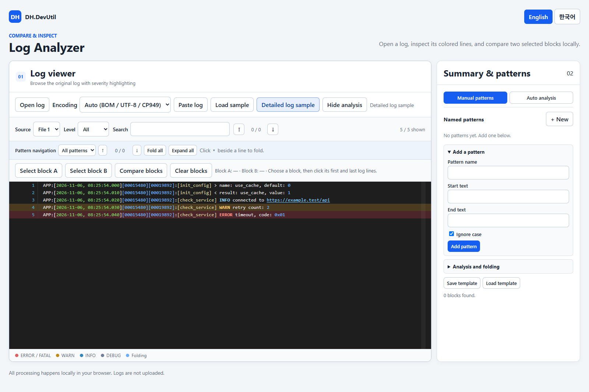

# Log Analyzer

[한국어](./LOG_ANALYZER.ko.md)

Inspect one log and compare selected blocks in a standalone HTML file.

## Screenshot

## Features

- Open or drop one file onto the viewer, or paste log text.
- Select UTF-8, CP949/EUC-KR, UTF-16 LE/BE, or Windows-1252. Changing the encoding reopens the selected file locally.
- Browse a large, scrollable log viewer with line numbers, severity coloring, text search, and level filtering.
- The log viewer and analysis panel resize with the browser height and share a matching height. On small screens the controls and minimum viewer height may require page scrolling.
- The viewer expands with the browser width; hiding the analysis panel gives the log more horizontal space.
- Highlight timestamps, bracketed numeric IDs and function names, numbers, hexadecimal values, and URLs; select a line to mark it. A detailed log sample demonstrates the colors.
- Search without hiding surrounding lines. Matches are highlighted in the viewer and marked in the right-hand overview bar; use the arrows or Enter/Shift+Enter to move between matches.
- Render only the visible lines to keep scrolling and searching responsive on larger logs.
- Try application, Apache/Nginx, IIS W3C, JSON Lines, key=value, and stack-trace samples.
- The right-hand summary and pattern panel is visible by default and can be hidden; use it to group similar lines and filter them by text or level.
- Use separate Manual patterns and Auto analysis tabs in the right-hand panel. Auto analysis groups similar lines heuristically; manual patterns define foldable start/end blocks.
- Create named patterns with start and end text, edit or delete them, fold matching blocks in the log, and save or load pattern templates as JSON.
- The pattern list shows each start/end condition and case option. Edit opens the populated form; save the template again to keep edits in a downloaded file.
- Use the pattern navigation bar above the log, or a pattern's Find button in the analysis panel, to jump between matching blocks. Pattern start lines show a folding control and the pattern name.
- After choosing Find, use Previous and Next inside the selected pattern card; its position stays synchronized with the viewer's navigation bar. Pattern editing and extra analysis actions are collapsible.
- An occurrence list opens automatically when one pattern finds blocks; with multiple patterns, select **Find** on a pattern card to open its list, then **Hide** to close it. Lists show line ranges, available timestamps, a selectable base block, and per-block comparison. They distinguish identical raw text, matches excluding leading timestamp/IDs, differences, and comparisons too large to summarize; load additional entries with **Show more**.
- The comparison dialog offers changed-lines-only view, inline changed-text emphasis, and previous/next difference navigation. Each side has one scroll area rather than one scrollbar per line; vertical and horizontal scrolling are synchronized where possible.
- Select the first and last lines of two blocks in the log and compare them side by side; choose original lines, hidden timestamp/ID prefixes, or normalized placeholders, and save the comparison as text.
- Switch between English and Korean.

## How to use

1. Open [Log Analyzer](../tools/DH.DevUtil.log-analyzer.html) and load one log file or a sample.
2. Open **Summary & patterns** when you want to inspect detected patterns.
3. Choose **Select block A**, click its first and last lines, then repeat for block B.
4. Choose **Compare blocks**. The comparison dialog fits the browser window and resizes with it. Original lines are shown by default while recognized leading timestamps and IDs are ignored in comparison. Use **Display** to hide those prefixes or show normalized placeholders; clear **Ignore leading timestamp / IDs** to include them in non-normalized comparison.
5. For folding, open the analysis panel, add a named pattern with start and end text, and use the markers beside the matching line numbers. Registration analyzes the current log automatically; **Reanalyze** runs it again and expands folded blocks. The pattern navigation bar moves to previous/next blocks. Use **Save template** or **Load template** to reuse pattern definitions.
6. Review the automatically opened occurrence list, or select **Find** on a pattern when several are registered. Choose **Set base** and then **Compare** on another block. Choose the desired display and comparison mode in the dialog.

## Limitations

- The comparison dialog reports how many lines have a recognized timestamp or numeric header ID and how many prefixes were not recognized. It detects bracketed and leading ISO timestamps and common syslog headers. Adjacent bracketed numeric IDs or a single long numeric ID are treated as header IDs; an isolated short value such as `[500]` remains part of the message. Unrecognized lines are compared unchanged. This is a format-based heuristic, so check the counts and clear the ignore checkbox if the detected fields are meaningful.
- Pattern matching replaces common timestamps, IPv4 addresses, UUIDs, and numbers. It is heuristic and may group unrelated lines or separate similar ones.
- The IIS parser requires a `#Fields:` header; access logs use a common combined-log layout. Stack traces are compared line by line, not as complete events.
- Auto encoding detection checks UTF-8/UTF-16 BOMs, then strict UTF-8, then CP949/EUC-KR. It is a heuristic: ASCII and other valid UTF-8 byte sequences may also be valid in legacy encodings. Choose an encoding manually if text looks wrong; UTF-16 without a BOM requires manual selection.
- Files are decoded into memory. Very large comparisons use positional alignment when the line-pair matrix would exceed one million cells.
- The complete decoded log and search matches are still held in memory; performance depends on file size and browser resources. The level filter limits which lines and matches are shown.
- Named patterns use literal text and optionally ignore case. The first subsequent end line closes a block; start and end lines are included. When blocks overlap, the earliest block takes precedence and the number omitted is shown. Search and level filters temporarily display all lines rather than keeping blocks folded. Templates contain pattern definitions, not log contents.
- Occurrence summaries ignore recognized leading timestamps and numeric IDs, but retain other numeric values. Prefix detection recognizes common leading ISO timestamps and bracketed timestamp/numeric-ID prefixes; unrecognized formats remain unchanged. Display selection and the prefix-ignore checkbox are separate: raw timestamps can remain visible while ignored. Normalized-placeholder mode also normalizes numbers and IPs in the message. The differences-only occurrence filter uses the prefix-ignored comparison. Counts cover only the loaded portion of the list; large comparisons can be left unsummarized, and the comparison dialog falls back to positional alignment above one million line pairs. Inline highlighting shows the changed span between the common prefix and suffix, not a full word-level diff.
- Expanded manual blocks show a start control, connecting line, and end marker in the line-number gutter. Collapsed blocks show their full line range on the start line. The overview bar shows folding blocks in blue and search results in yellow; clicking the blue side jumps to the nearest block.
- Block selection uses the original line numbers even when the viewer is filtered. The parser does not perform server-side validation or infer causes.

## Privacy

Logs stay in the browser; no log data is uploaded. Saved comparison files are written only when requested.
