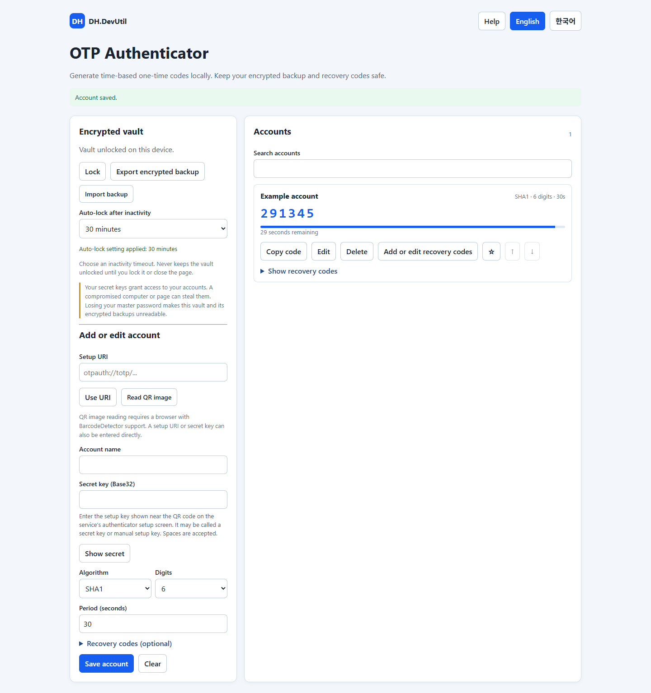

# OTP Authenticator

[English](./OTP_AUTHENTICATOR.md)

표준 `otpauth://totp` 등록을 지원하는 서비스를 위한 독립 실행형 로컬 TOTP 인증 도구입니다. 서비스 전용 푸시 승인이나 전용 모바일 Agent는 지원하지 않습니다.

## 사용 방법

도구 상단의 **도움말**에서 등록 절차와 서비스의 등록 키, 변경되는 OTP, 복구 코드의 차이를 확인할 수 있습니다. 비밀 키 입력란에도 등록 키의 위치를 안내합니다.

1. 지원하는 브라우저에서 [OTP Authenticator](../tools/DH.DevUtil.otp-authenticator.html)를 열고 12자 이상의 마스터 비밀번호로 보관함을 만듭니다.
2. 계정 이름과 Base32 비밀 키를 입력하거나 TOTP 등록 URI를 적용합니다. 브라우저가 `BarcodeDetector`를 지원하면 QR 이미지도 읽을 수 있습니다. 지원하지 않으면 등록 URI나 비밀 키를 직접 입력하세요.
3. 서비스에 맞는 알고리즘, 자릿수, 주기를 선택하고 계정을 저장합니다. 서비스에서 코드가 정상 동작하는지 확인하고 복구 코드도 보관하세요.
4. 계정을 검색·수정·삭제·즐겨찾기·순서 변경하거나 코드를 복사합니다. 암호화 백업을 별도로 안전하게 보관하세요. 백업을 불러오면 확인 후 기존 보관함을 교체하며 해당 백업의 원래 비밀번호가 필요합니다.

계정을 추가하거나 수정할 때 복구 코드를 선택적으로 입력할 수 있습니다. 서비스에서 등록 후 코드를 발급했다면 해당 계정 카드의 **복구 코드 추가·수정**을 눌러 입력하세요. 복구 코드는 펼치기 전까지 숨겨지며 암호화 보관함과 백업에 포함됩니다. 복구 코드는 일반적으로 한 번만 사용할 수 있으며 이 도구는 사용 여부를 추적하지 않습니다. 보관함이나 비밀번호를 잃을 때를 대비해 별도 사본도 보관하세요.

자동 잠금 기본 시간은 30분이며 5분·15분·30분·1시간 또는 자동 잠금 안 함을 선택할 수 있습니다. 설정이 적용되면 선택란 아래에 확인 메시지가 나타납니다. 다른 프로그램에서의 작업은 이 도구의 타이머를 초기화하지 않습니다. 설정은 이 브라우저에 별도로 저장되며 보관함 백업에는 포함되지 않습니다. 자동 잠금을 끄면 페이지를 닫거나 직접 잠그기 전까지 비밀 정보가 메모리에 남습니다. 브라우저 저장소는 브라우저와 출처(origin)에 따라 분리되며 삭제되거나 시크릿 모드에서 사용할 수 없을 수 있습니다. 별도 백업을 보관하고 사용 전 복구를 확인하세요.

## 보안과 제한

Web Crypto의 PBKDF2-SHA-256(600,000회)과 임의 salt·nonce를 사용하는 AES-256-GCM으로 계정 데이터를 로컬 저장소와 백업에 암호화합니다. 잠금 해제 중에는 비밀 키가 메모리에 복호화됩니다. 마스터 비밀번호 유출, 악성 페이지·브라우저 확장 프로그램 또는 PC 침해로 키가 노출될 수 있습니다. 비밀번호와 OTP를 같은 PC에 보관하면 인증 요소 분리 효과가 줄어듭니다. OTP는 피싱 방지 방식이 아니며 PC 시간이 정확해야 합니다. 마스터 비밀번호는 복구할 수 없습니다. 이 구현은 독립적인 보안 감사를 받지 않았으므로 중요 계정에 사용하기 전에 평가하세요.

계정 동기화는 제공하지 않습니다. QR 이미지는 로컬에서 처리하며 브라우저 지원이 필요합니다. Web Crypto와 브라우저 저장소가 필요하고 클립보드 사용은 브라우저 권한에 따라 달라집니다.
