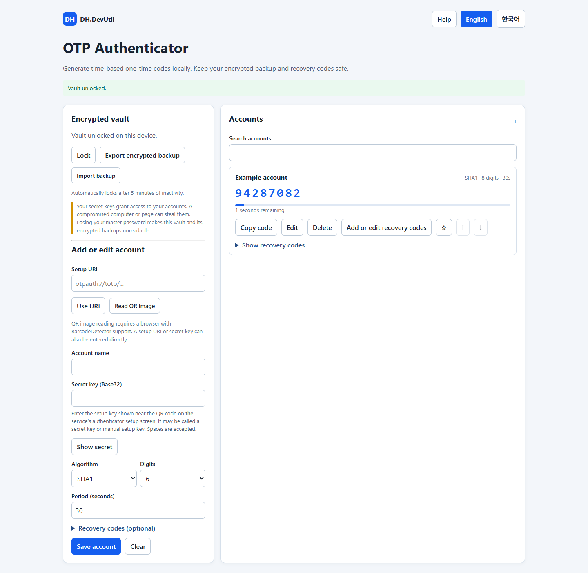

# OTP Authenticator

[한국어](./OTP_AUTHENTICATOR.ko.md)

A standalone, local TOTP authenticator for services that support standard `otpauth://totp` setup. It does not support proprietary push approval or provider-specific mobile agents.

## Use

Select **Help** in the tool for setup instructions and the distinction between the service's setup key, changing OTP, and recovery codes. The secret-key field also explains where to find the setup key.

1. Open [OTP Authenticator](../tools/DH.DevUtil.otp-authenticator.html) in a supported browser and create a vault with a master password of at least 12 characters.
2. Enter the account name and Base32 secret, or apply a TOTP setup URI. A QR image can be read when the browser supports `BarcodeDetector`; otherwise use the setup URI or secret.
3. Select the service's algorithm, digits and period. Save the account, verify its code with the service, and retain the service's recovery codes.
4. Search, edit, delete, favorite, reorder, or copy codes. Export an encrypted backup and store it safely. Import replaces the current vault after confirmation and requires the backup's original password.

Optionally add recovery codes when adding or editing an account, or choose **Add or edit recovery codes** on an existing account after the service issues them. They remain hidden until opened and are included in the encrypted vault and backup. Services generally accept each recovery code only once; the tool does not track whether a code has been used. Keep a separate copy in case you lose access to the vault or its password.

The vault locks after five minutes of inactivity. Browser storage is specific to the browser and origin and can be cleared or unavailable in private browsing. Keep a separate backup and test recovery before relying on the tool.

## Security and limitations

The page uses Web Crypto PBKDF2-SHA-256 (600,000 iterations) and AES-256-GCM with random salt and nonce to encrypt account data in local storage and the backup. Secrets are decrypted in memory while unlocked. A stolen master password, malicious page, browser extension, or compromised computer can expose them. The same computer holding both passwords and OTP secrets reduces factor separation. OTP is not phishing-resistant. The computer clock must be accurate. Master passwords cannot be recovered. This implementation has not undergone an independent security audit; evaluate it before using it for critical accounts.

The tool does not sync accounts. A QR image is processed locally and requires browser support. The page requires Web Crypto and browser storage; clipboard access also depends on browser permissions.
