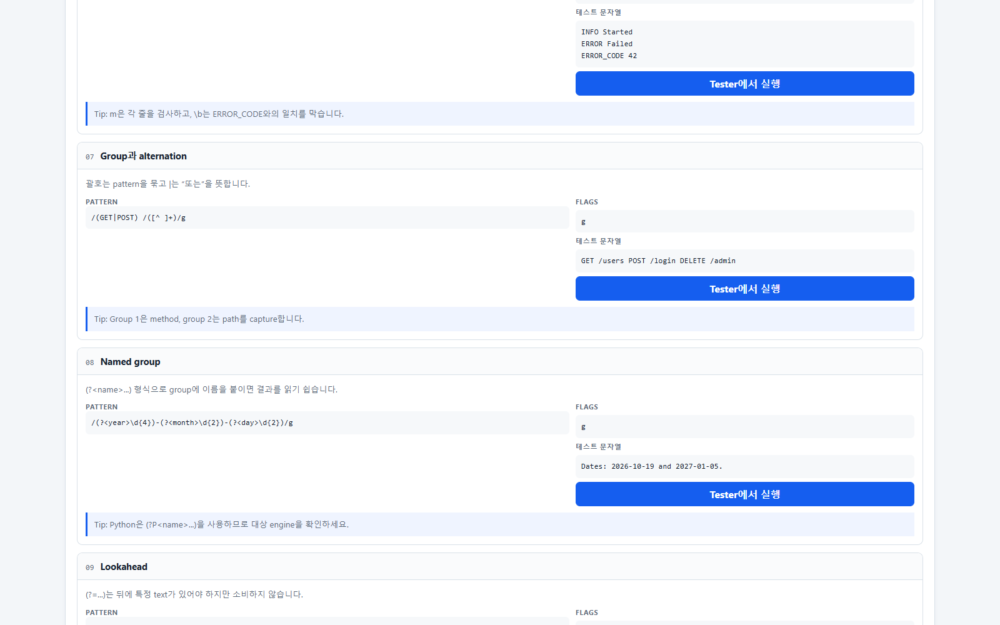
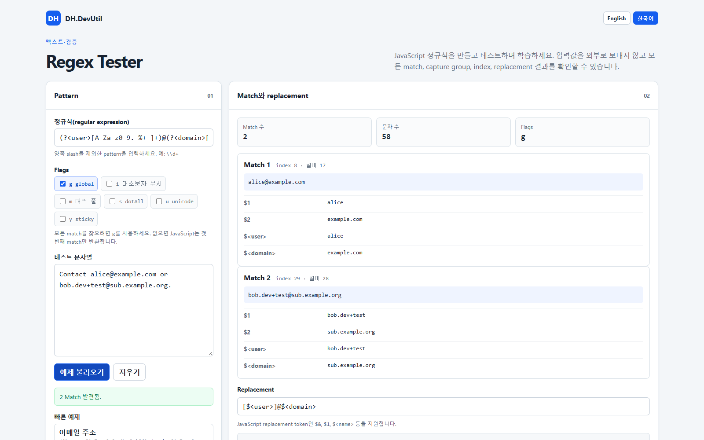

# Regex Tester

[English](./REGEX_TESTER.md)

Regex Tester는 브라우저에서 JavaScript 정규식(regular expression)을 만들고 이해하도록 돕는 도구입니다. 모든 match, capture group, named group, 위치(index), replacement 결과를 보여줍니다.

## 화면 미리보기

## 기능

- JavaScript `RegExp`의 `g`, `i`, `m`, `s`, `u`, `y` flag 테스트
- match 개수, 문자 수, match 문자열, index, 길이, 번호가 있는 capture group, named capture group 표시
- `$&`, `$1`, `$<name>` 같은 JavaScript replacement token 미리보기
- 이메일 주소, 로그 level, 날짜, 공백 정리 예제 제공
- 전체 UI를 English·한국어로 전환하고 선택한 UI 언어와 Learn more 언어를 브라우저에 기억
- 현재 pattern과 flag가 JavaScript, Python `re`, .NET `Regex`, Java `Pattern`, PCRE2, Rust `regex`에서 어떻게 표현되는지 미리보기
- 정규식 구성 요소와 engine별 차이를 English·한국어로 설명
- 현재 브라우저에서 pattern과 테스트 문자열을 로컬 처리하며 network 요청이나 입력값 영구 저장을 하지 않음

## 사용 방법

1. 최신 브라우저에서 [Regex Tester](../tools/DH.DevUtil.regex-tester.html)를 엽니다.
2. 양쪽 slash를 제외한 pattern을 입력합니다. 예를 들어 `/\\d+/g`가 아니라 `\\d+`를 입력합니다.
3. flag를 선택합니다. `g`를 선택하면 모든 match를 찾고, 선택하지 않으면 JavaScript는 첫 번째 match만 반환합니다.
4. 테스트 문자열을 입력하거나 붙여 넣습니다. 입력과 동시에 결과가 갱신됩니다.
5. 각 match, capture group, replacement 미리보기를 확인합니다.
6. 학습 중이라면 Quick examples에서 예제를 선택하세요. Learn more에서 literal, character class, quantifier, group, anchor, alternative의 역할을 확인할 수 있습니다.
7. 오른쪽 위의 **English** 또는 **한국어**를 선택하면 전체 UI 언어를 바꿀 수 있습니다.
8. **언어별 정규식 미리보기**에서 다른 언어의 pattern과 flag 표현을 비교하세요. 일부 flag는 compile option이 아니라 반복 matching API 동작이므로 차이 설명도 함께 표시합니다.

더 긴 학습이 필요하면 오른쪽 위의 **Regex 학습 가이드** 버튼을 누르세요. 내부 popup에서 초보자용 단계별 설명, 실전 예제, 성능 주의 사항과 각 예제를 Tester 입력값으로 불러오는 **Tester에서 실행** 버튼을 제공합니다.

## JavaScript와 다른 정규식 flavor

이 도구는 브라우저의 JavaScript `RegExp` engine을 사용합니다. 기본 개념은 여러 언어에서 비슷하지만 세부 문법은 다릅니다. Python은 named group에 `(?P<name>...)`을 사용하고 JavaScript는 `(?<name>...)`을 사용합니다. replacement 문법도 언어마다 다릅니다. Lookbehind, Unicode property, backreference, atomic group, recursion, flag 지원도 일치하지 않을 수 있으므로 실제 실행할 engine에서 반드시 테스트하세요.

## 참고 및 제한

- 테스트 문자열이나 pattern의 JavaScript code를 실행하지 않습니다. `RegExp` 객체를 만들고 matching·replacement API만 호출합니다.
- 페이지 반응성을 위해 화면에는 최대 1,000개의 match를 표시합니다. Replacement preview는 브라우저의 일반 replacement 동작을 사용합니다.
- `(a+)+`처럼 모호한 중첩 quantifier는 특정 입력에서 JavaScript 정규식을 매우 느리게 만들 수 있습니다. 중요한 service에서 검증되지 않은 pattern으로 큰 외부 입력을 처리하지 마세요.
- HTML, JSON, programming language처럼 nesting이 있는 구조를 정규식만으로 완전하게 parse하려고 하지 마세요. 이런 형식에는 전용 parser를 사용하세요.

## 개인정보 보호

모든 처리는 현재 브라우저 tab에서 이루어집니다. server endpoint, 외부 library, upload 기능, 입력값 영구 저장 기능이 없습니다. Learn more 언어 선택만 `localStorage`에 저장될 수 있습니다.
