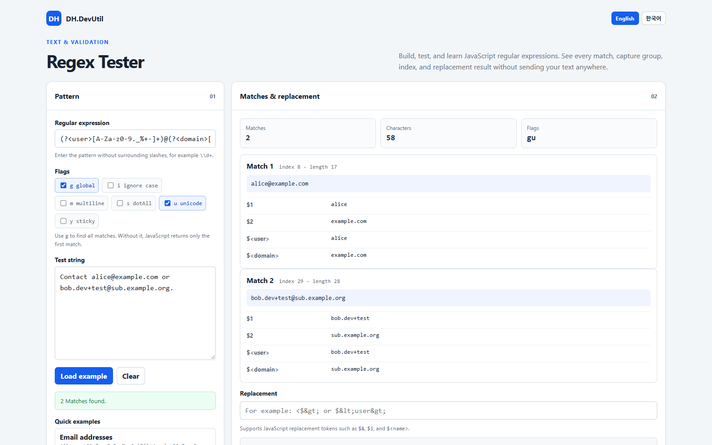
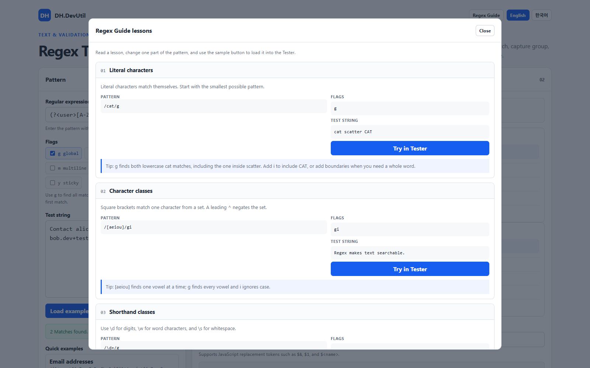

# Regex Tester

[한국어](./REGEX_TESTER.ko.md)

Regex Tester helps you build and understand JavaScript regular expressions in the browser. It shows every match, capture group, named group, position, and replacement result.

## Screenshot

## Features

- Test a JavaScript `RegExp` pattern with `g`, `i`, `m`, `s`, `u`, and `y` flags.
- Display match count, character count, match text, index, length, numbered capture groups, and named capture groups.
- Preview JavaScript replacement tokens such as `$&`, `$1`, and `$<name>`.
- Load examples for email addresses, log levels, dates, and whitespace cleanup.
- Switch the complete interface between English and Korean; the selected interface and Learn more language are remembered locally.
- Preview the current pattern and flag behavior in JavaScript, Python `re`, .NET `Regex`, Java `Pattern`, PCRE2, and Rust `regex` syntax.
- Explain common regex building blocks and engine differences in English and Korean.
- Process the pattern and test string locally in the current browser. No network request or persistent input storage is used.

## How to use

1. Open [Regex Tester](../tools/DH.DevUtil.regex-tester.html) in a modern browser.
2. Enter a pattern without surrounding slashes. For example, enter `\\d+`, not `/\\d+/g`.
3. Select flags. Use `g` to find all matches; without `g`, JavaScript returns only the first match.
4. Enter or paste the test string. Results update as you type.
5. Inspect each match, its capture groups, and the replacement preview.
6. Start with a Quick example if you are learning. Read the Learn more panel for the role of literals, character classes, quantifiers, groups, anchors, and alternatives.
7. Select **English** or **한국어** in the top-right language switch to translate the complete interface.
8. Use **Regex flavor preview** to compare how the current pattern and flags are represented in another language. Some flags are API behavior rather than compile options, so the panel explains those differences.

For a longer lesson, open the internal **Regex Guide** popup from the top-right button. It contains beginner-friendly lessons, practical samples, performance warnings, and a **Try in Tester** button for every sample.

## JavaScript and other regex flavors

This tool intentionally uses the browser's JavaScript `RegExp` engine. Regex basics are shared across languages, but details differ. Python uses `(?P<name>...)` for named groups while JavaScript uses `(?<name>...)`; replacement syntax also differs between languages. Lookbehind, Unicode properties, backreferences, atomic groups, recursion, and flags are not supported consistently. Test a pattern in the engine that will run it.

## Notes and limits

- The tool does not execute JavaScript code from the test string or pattern; it only constructs a `RegExp` object and runs matching and replacement APIs.
- At most 1,000 matches are displayed to keep the page responsive. The replacement preview still uses the browser's normal replacement behavior.
- JavaScript regular expressions can become very slow with ambiguous nested quantifiers such as `(a+)+` on carefully chosen input. Avoid using unreviewed patterns for large untrusted input in critical services.
- A regex is not a complete parser for structured languages such as HTML, JSON, or programming languages. Use a real parser when the format has nesting or escaping rules.

## Privacy

All processing happens in the current browser tab. The tool has no server endpoint, external library, upload control, or input persistence. Only the Learn more language selection may be stored in `localStorage`.
