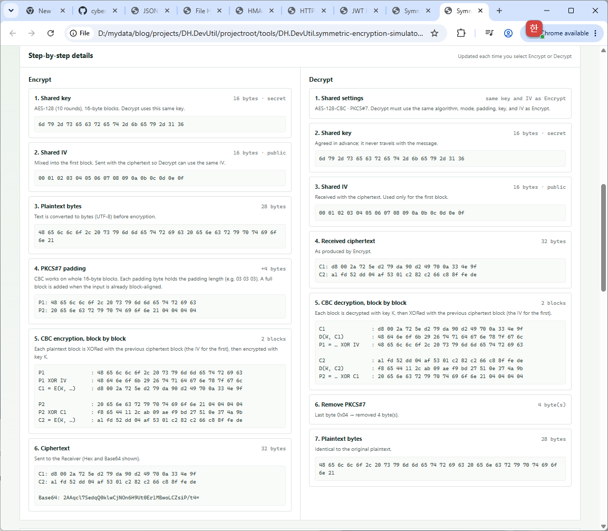
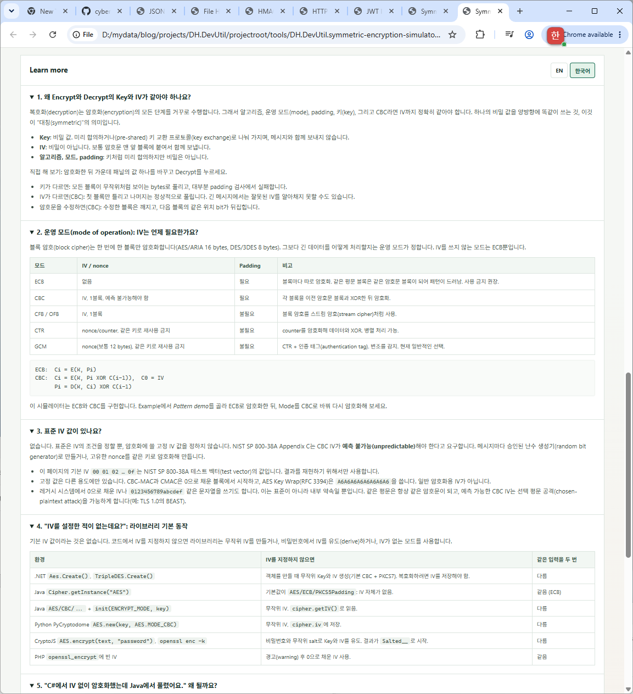

# Symmetric Encryption Simulator (Base)

[English](./SYMMETRIC_ENCRYPTION_SIMULATOR_BASE.md)

Symmetric Encryption Simulator (Base)는 대칭 암호화(symmetric encryption)가 무엇인지 보여 주는 브라우저 기반 학습 도구입니다. Encrypt와 Decrypt는 **같은 비밀 키(secret key)**, 같은 IV, 같은 알고리즘·모드·padding을 사용합니다. 화면에서도 이 공유 값을 Encrypt와 Decrypt 사이 가운데에 두어, 양쪽이 한 곳의 값을 함께 쓴다는 점이 보이도록 했습니다.

IV는 기본적으로 고정되어 있어 입력이 같으면 항상 같은 암호문이 나옵니다. 그래서 키·평문·암호문의 관계를 쉽게 확인하고, 강의나 블로그에서 결과를 그대로 재현할 수 있습니다. AES-GCM/CTR과 무작위 IV를 지원하는 도구는 [Symmetric Encryption Simulator](./SYMMETRIC_ENCRYPTION_SIMULATOR.ko.md)를 참고하세요.

## 화면 미리보기


Encrypt, 공유 키·IV 패널, Decrypt를 한 화면에서 확인할 수 있습니다.



단계별 상세(Step-by-step details): Encrypt와 Decrypt 과정을 블록 단위로 좌우에 표시합니다.



Learn more: 페이지 안 설명이며 EN / 한국어로 전환할 수 있습니다.

이미지에는 도구 화면 설명을 위한 데모 키와 테스트 값이 포함되어 있습니다. 실제 운영 키나 민감한 데이터를 입력하지 마세요.

## 기능

- 블록 암호(block cipher): **AES**(128/192/256-bit 키), **ARIA**(128/192/256-bit 키, RFC 5794 / KS X 1213), **3DES**(2-key 또는 3-key EDE), **DES**
- 운영 모드(mode of operation): **CBC**(IV 사용), **ECB**(IV 없음). ECB에서는 IV 입력이 비활성화됨
- Padding: PKCS#7, ANSI X.923, ISO/IEC 7816-4, Zero padding, No padding. 입력하는 동안 평문 길이, padding으로 추가되는 bytes, 결과 블록 수를 표시
- 화면 구성: **01 Encrypt** | **02 Shared by both sides**(예제, 알고리즘, 모드, padding, 키, IV) | **03 Decrypt**(Hex/Base64 수신 암호문, 도청자 보기, 결과)
- 기본 결정적(deterministic) 동작: 고정 IV(`00 01 02 …`, 1블록 길이)와 **Run #n · same inputs → identical ciphertext** 배지로 같은 입력의 같은 결과, 또는 어떤 입력이 바뀌었는지 표시
- **Random IV** 버튼: 실제 시스템이 메시지마다 새 IV를 쓰는 이유 확인. 암호문은 바뀌지만 Decrypt도 같은 IV를 쓰므로 복호화됨
- 암호화 후 공유 값을 바꾸고 복호화하면, 무엇이 바뀌었는지와 원래 블록과 다른 블록을 표시. 예: CBC에서 IV가 틀리면 `P1`만 깨짐
- 수신 암호문을 수정해 변조(tampering) 실험
- **Pattern demo**: 같은 평문 블록 2개. ECB는 `C1 = C2`, CBC는 서로 다른 블록
- 시뮬레이터 하단에 Encrypt/Decrypt 단계별 상세를 좌우로 표시: 키, IV, 평문 bytes, padding, 블록별 계산(`P XOR 이전 블록 → E(K, …)` 또는 `E(K, P)`), padding 검사·제거
- 페이지 안 **Learn more** 설명. **EN** / **한국어** 전환 버튼 제공(브라우저 언어가 한국어면 한국어로 시작, 선택 값 기억):
  - 키와 IV가 같아야 하는 이유
  - 모드별 IV 필요 여부
  - 표준 IV가 있는지
  - IV를 지정하지 않을 때 라이브러리 기본 동작(.NET, Java, Python, CryptoJS/OpenSSL, PHP)
  - "C#에서 IV 없이 암호화 → Java 복호화"가 되는 이유
  - padding과 "No padding" 오류
  - 알고리즘 표
- 테스트 벡터: AES-128/256-CBC(NIST SP 800-38A F.2.1, F.2.5), AES-128-ECB(F.1.1), ARIA-128/256(RFC 5794), DES 고전 예제. 공개된 기대값과 비교
- 암호 알고리즘을 HTML 파일 안에 순수 JavaScript로 구현. 외부 라이브러리, 네트워크 요청, 저장 없음

## 사용 방법

1. 최신 브라우저에서 [`DH.DevUtil.symmetric-encryption-simulator-base.html`](../tools/DH.DevUtil.symmetric-encryption-simulator-base.html)을 엽니다.
2. 가운데 패널에서 알고리즘, 모드, padding을 선택합니다. 길이가 맞는 데모 키와 고정 IV가 입력됩니다.
3. **Encrypt**를 누릅니다. 다시 눌러도 암호문은 같습니다.
4. **Decrypt**를 누르면 같은 키와 IV로 원래 평문이 복원됩니다.
5. 가운데 패널의 키를 한 글자 바꾸고 **Decrypt**를 누릅니다. PKCS#7, ANSI X.923, ISO/IEC 7816-4는 대부분 padding 검사에서 거부되고, Zero/No padding은 오류 없이 의미 없는 bytes가 나옵니다.
6. 키를 되돌리고 IV의 첫 byte를 바꿔 복호화합니다. CBC에서는 첫 블록만 틀립니다.
7. **Example**에서 **Pattern demo**를 골라 ECB로 암호화한 뒤, Mode를 CBC로 바꿔 다시 암호화합니다.
8. **Random IV**를 누르고 두 번 암호화해 고정 IV와 비교합니다.
9. **Example**에서 테스트 벡터를 골라 공개된 값과 결과를 검증합니다.

## 알고리즘

| 알고리즘 | 블록 | 키 | 라운드(rounds) | 상태 |
|---|---|---|---|---|
| AES (FIPS 197) | 16 bytes | 16 / 24 / 32 bytes | 10 / 12 / 14 | 현재 표준 |
| ARIA (RFC 5794, KS X 1213) | 16 bytes | 16 / 24 / 32 bytes | 12 / 14 / 16 | 국내 표준 |
| 3DES (EDE) | 8 bytes | 16 bytes(K1, K2, K1) 또는 24 bytes(K1, K2, K3) | 3 × 16 | 레거시(legacy), NIST 암호화 용도 폐지 |
| DES | 8 bytes | 8 bytes(유효 56-bit) | 16 | 안전하지 않음, 역사 학습용 |

3DES는 `E(K3, D(K2, E(K1, P)))`로 암호화하고 역순으로 복호화합니다. DES 키의 parity bit는 무시합니다.

## 모드와 IV

```text
ECB:  Ci = E(K, Pi)
CBC:  Ci = E(K, Pi XOR C(i-1)),  C0 = IV
      Pi = D(K, Ci) XOR C(i-1)
```

| 모드 | IV / nonce | Padding |
|---|---|---|
| ECB | 없음 (패턴 노출) | 필요 |
| CBC | 1블록, 예측 불가능해야 함 | 필요 |
| CFB / OFB | 1블록 | 불필요 |
| CTR / GCM | nonce, 같은 키로 재사용 금지 | 불필요 |

암호화용 표준 고정 IV는 없습니다. 기본값 `00 01 02 … 0f`는 NIST SP 800-38A 테스트 벡터의 값입니다. NIST SP 800-38A는 CBC IV가 예측 불가능(unpredictable)해야 한다고 요구하며, 실제 시스템은 메시지마다 새 무작위 IV를 만들어 암호문과 함께 보냅니다.

## Padding

| Padding | 예시 (3 bytes 필요) | 비고 |
|---|---|---|
| PKCS#7 | `03 03 03` | 항상 추가 (블록 길이에 맞으면 1블록 전체 추가). 8/16-byte 블록에서는 Java `PKCS5Padding`과 동일 |
| ANSI X.923 | `00 00 03` | 항상 추가 |
| ISO/IEC 7816-4 | `80 00 00` | 항상 추가 |
| Zero padding | `00 00 00` | 필요할 때만 추가. 원래 데이터 끝의 0x00과 구분 불가 |
| No padding | — | 평문 길이가 블록 크기의 배수여야 함. 라이브러리는 자동으로 채우지 않고 오류 처리 |

## 검증

AES(FIPS 197 / NIST SP 800-38A), ARIA(RFC 5794), DES 테스트 벡터로 구현을 확인했고, 모든 알고리즘과 키 길이에 대해 ECB/CBC 결과를 OpenSSL과 교차 검증했습니다.

## 보안 안내

학습용 시뮬레이터이며 운영용 암호화 도구가 아닙니다. 키와 블록 중간값을 의도적으로 표시하고, 기본적으로 고정 IV를 사용하며, 암호 코드는 상수 시간(constant-time) 실행이 아니라 가독성을 우선해 작성했습니다. **운영 키나 민감한 데이터를 입력하지 마세요.**

ECB와 CBC는 데이터를 숨기지만 변조나 잘못된 키를 스스로 감지하지 못합니다. 실제 시스템은 AES-GCM 같은 인증 암호화(authenticated encryption)를 사용하거나 IV와 암호문에 HMAC을 추가합니다. 실제 데이터에 ECB를 쓰지 말고, DES는 사용하지 말며, 새 시스템에서는 3DES도 피하세요.
