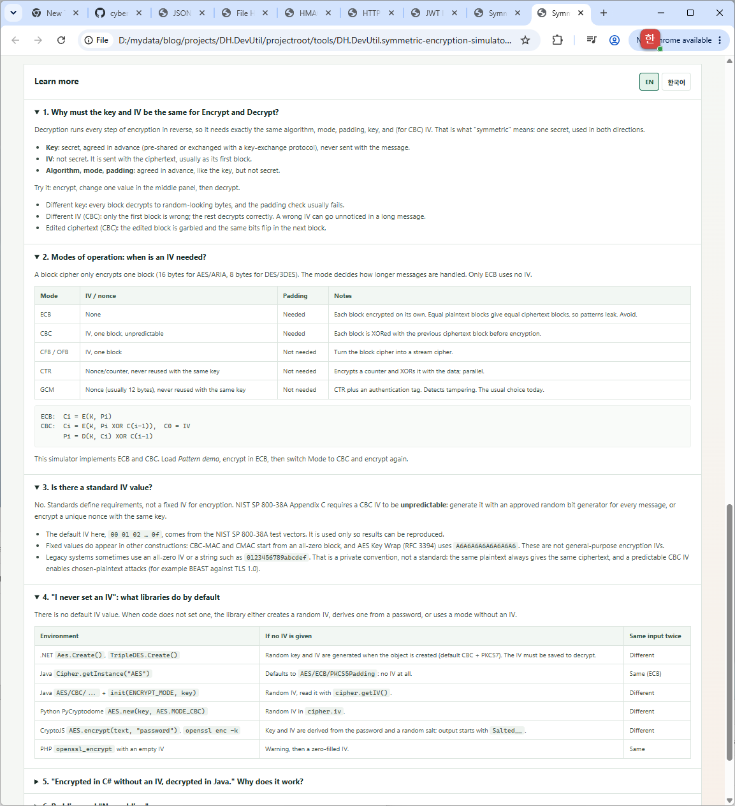

# Symmetric Encryption Simulator (Base)

[한국어](./SYMMETRIC_ENCRYPTION_SIMULATOR_BASE.ko.md)

Symmetric Encryption Simulator (Base) is a standalone, browser-based learning tool that shows what symmetric encryption is: Encrypt and Decrypt use **the same secret key**, the same IV, and the same algorithm, mode, and padding. The screen puts these shared values in the middle, between Encrypt and Decrypt, so both sides visibly read from one place.

The IV is fixed by default, so the same inputs always produce the same ciphertext. This makes the relationship between key, plaintext, and ciphertext easy to see and to reproduce in lectures or blog posts. For a feature-rich tool with AES-GCM/CTR and random IVs, see [Symmetric Encryption Simulator](./SYMMETRIC_ENCRYPTION_SIMULATOR.md).

## Screenshot


Encrypt, the shared key and IV panel, and Decrypt in one screen.


Step-by-step details: Encrypt and Decrypt side by side, block by block.



Learn more: explanations in the page, switchable between EN and 한국어.

The screenshots use demo keys and test values to illustrate the interface. Do not enter production keys or sensitive data.

## Features

- Block ciphers: **AES** (128/192/256-bit keys), **ARIA** (128/192/256-bit keys, RFC 5794 / KS X 1213), **3DES** (2-key or 3-key EDE), and **DES**.
- Modes: **CBC** (with IV) and **ECB** (no IV). The IV field is disabled in ECB.
- Padding: PKCS#7, ANSI X.923, ISO/IEC 7816-4, Zero padding, and No padding. The plaintext length, the bytes each padding adds, and the resulting block count are shown as you type.
- Layout: **01 Encrypt** | **02 Shared by both sides** (example, algorithm, mode, padding, key, IV) | **03 Decrypt** (received ciphertext in Hex or Base64, eavesdropper view, result).
- Deterministic by default: a fixed IV (`00 01 02 …`, one block long) and a run badge that shows **Run #n · same inputs → identical ciphertext**, or which input changed.
- **Random IV** button to show why real systems use a new IV per message: the ciphertext changes, and Decrypt still works because it uses the same IV.
- Change a shared value after encrypting, then decrypt to see the effect. Decrypt reports what changed and which blocks differ from the original. For example, a wrong IV in CBC breaks only `P1`.
- Edit the received ciphertext to simulate tampering.
- **Pattern demo**: two identical plaintext blocks. ECB gives `C1 = C2`; CBC makes them different.
- Step-by-step details below the simulator, Encrypt and Decrypt side by side: key, IV, plaintext bytes, padding, each block (`P XOR previous → E(K, …)` or `E(K, P)`), padding check and removal.
- **Learn more** section in the page, switchable between **EN** and **한국어** (Korean browsers start in Korean; the choice is remembered):
  - why the key and IV must match;
  - which modes need an IV;
  - whether a standard IV exists;
  - what libraries do when no IV is set (.NET, Java, Python, CryptoJS/OpenSSL, PHP);
  - why "C# without an IV → Java" can work;
  - padding and "No padding" errors;
  - an algorithm table.
- Test vectors: AES-128/256-CBC (NIST SP 800-38A F.2.1, F.2.5), AES-128-ECB (F.1.1), ARIA-128/256 (RFC 5794), and the classic DES example. The result is compared with the published value.
- The ciphers are implemented in plain JavaScript inside the HTML file. No external libraries, network requests, or persistence.

## How to use

1. Open [`DH.DevUtil.symmetric-encryption-simulator-base.html`](../tools/DH.DevUtil.symmetric-encryption-simulator-base.html) in a modern browser.
2. In the middle panel, select an algorithm, mode, and padding. A demo key of the correct length and a fixed IV are loaded.
3. Select **Encrypt**. Select it again: the ciphertext stays the same.
4. Select **Decrypt**. The same key and IV return the original plaintext.
5. Change one character of the key in the middle panel and select **Decrypt**. With PKCS#7, ANSI X.923, or ISO/IEC 7816-4, the padding check usually rejects the result; with Zero or No padding, garbage bytes are returned without an error.
6. Restore the key, change the first byte of the IV, and decrypt: in CBC only the first block is wrong.
7. Select **Pattern demo** in **Example**, encrypt in ECB, then switch Mode to CBC and encrypt again.
8. Select **Random IV** and encrypt twice to compare with the fixed-IV behavior.
9. Select a test vector from **Example** to verify the implementation against published values.

## Algorithms

| Algorithm | Block | Key | Rounds | Status |
|---|---|---|---|---|
| AES (FIPS 197) | 16 bytes | 16 / 24 / 32 bytes | 10 / 12 / 14 | Current standard |
| ARIA (RFC 5794, KS X 1213) | 16 bytes | 16 / 24 / 32 bytes | 12 / 14 / 16 | Korean standard |
| 3DES (EDE) | 8 bytes | 16 bytes (K1, K2, K1) or 24 bytes (K1, K2, K3) | 3 × 16 | Legacy; retired by NIST for encryption |
| DES | 8 bytes | 8 bytes (56-bit effective) | 16 | Broken; history only |

3DES encrypts as `E(K3, D(K2, E(K1, P)))` and decrypts in reverse. DES key parity bits are ignored.

## Modes and IV

```text
ECB:  Ci = E(K, Pi)
CBC:  Ci = E(K, Pi XOR C(i-1)),  C0 = IV
      Pi = D(K, Ci) XOR C(i-1)
```

| Mode | IV / nonce | Padding |
|---|---|---|
| ECB | None (patterns leak) | Needed |
| CBC | One block, unpredictable | Needed |
| CFB / OFB | One block | Not needed |
| CTR / GCM | Nonce, never reused with the same key | Not needed |

There is no standard fixed IV for encryption. The default `00 01 02 … 0f` comes from the NIST SP 800-38A test vectors. NIST SP 800-38A requires an unpredictable CBC IV, and real systems send a new random IV with each ciphertext.

## Padding

| Padding | Example (3 bytes needed) | Note |
|---|---|---|
| PKCS#7 | `03 03 03` | Always adds padding (a full block when aligned). Same as Java `PKCS5Padding` for 8- and 16-byte blocks. |
| ANSI X.923 | `00 00 03` | Always adds padding. |
| ISO/IEC 7816-4 | `80 00 00` | Always adds padding. |
| Zero padding | `00 00 00` | Adds padding only when needed; original trailing zero bytes cannot be told apart. |
| No padding | — | The plaintext must already be a multiple of the block size. Libraries reject a partial block instead of filling it. |

## Verification

The implementations were checked against the AES (FIPS 197 / NIST SP 800-38A), ARIA (RFC 5794), and DES test vectors. ECB and CBC output was cross-checked with OpenSSL for every algorithm and key size.

## Security note

This is an educational simulator, not a production encryption tool. It intentionally displays keys and intermediate block values, uses a fixed IV by default, and its cipher code is written for readability, not for constant-time execution. **Do not enter production keys or sensitive data.**

ECB and CBC hide data but do not detect tampering or a wrong key by itself. Real systems use authenticated encryption such as AES-GCM, or add an HMAC over the IV and ciphertext. Do not use ECB for real data, do not use DES, and avoid 3DES in new systems.
