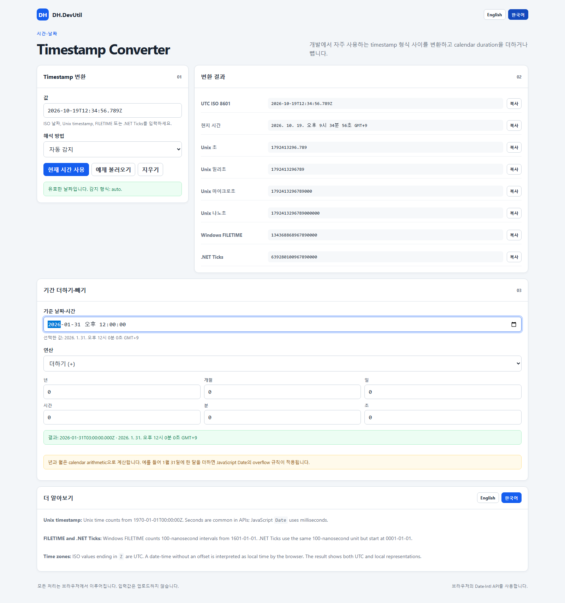

# Timestamp Converter

[한국어](./TIMESTAMP_CONVERTER.ko.md)

Timestamp Converter converts common developer time formats in the browser and calculates a new date by adding or subtracting years, months, days, hours, minutes, and seconds.

## Screenshot

## Features

- Convert ISO 8601 and browser date text.
- Convert Unix seconds, milliseconds, microseconds, and nanoseconds.
- Convert Windows FILETIME (100-nanosecond intervals since 1601-01-01).
- Convert .NET Ticks (100-nanosecond intervals since 0001-01-01).
- Auto-detect numeric Unix units by the size of the value.
- Show UTC ISO 8601, local time, Unix units, FILETIME, and .NET Ticks together.
- Format the local date/time with the selected UI language; Korean UI uses Korean date and AM/PM wording while ISO output stays standard.
- Show a localized preview below the native `datetime-local` control because the control's own visual format is provided by the browser and operating system.
- Add or subtract a duration using calendar years/months plus days, hours, minutes, and seconds.
- Switch the interface and Learn more panel between English and Korean.
- Process all values locally with the browser's `Date` and `Intl` APIs.

## How to use

1. Open [Timestamp Converter](../tools/DH.DevUtil.timestamp-converter.html) in a modern browser.
2. Enter an ISO date or numeric timestamp. Choose **Interpret as** when Auto detect is not appropriate.
3. Read the converted values. Use **Copy** on any row to copy one result.
4. For date arithmetic, enter a local base date and time, choose **Add (+)** or **Subtract (-)**, and enter the duration fields.
5. Use **Use current time** or **Load example** to begin quickly.

## Important details

- Unix timestamps are measured from 1970-01-01T00:00:00Z.
- JavaScript `Date` stores milliseconds, so sub-millisecond inputs are converted to the nearest representable millisecond for the displayed date. The corresponding large-unit output is derived from that Date value.
- ISO values ending in `Z` are UTC. A date-time without an offset is interpreted as local time by the browser.
- Years and months use JavaScript calendar arithmetic. Adding one month to January 31 can overflow into March; this is different from adding a fixed number of days.
- FILETIME and .NET Ticks can exceed JavaScript's safe integer range. The tool accepts them as `Number`, so extremely large values may lose integer precision.

## Privacy

All processing happens in the current browser tab. The tool has no server endpoint, external library, upload control, or persistent input storage. The selected interface language may be saved in `localStorage`.
